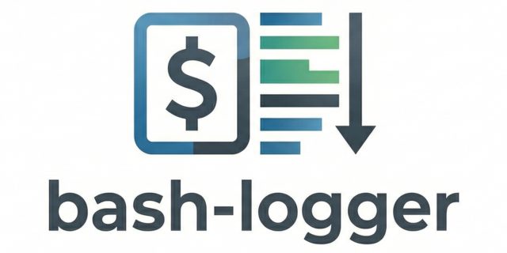

# Bash Logger


[](https://opensource.org/licenses/MIT)
[](https://github.com/GingerGraham/bash-logger/actions/workflows/release.yml)
[](https://github.com/GingerGraham/bash-logger/actions/workflows/tests.yml)




A flexible, reusable logging module for shell scripts that provides standardized logging functionality with various configuration options.
It runs in bash 3.2+, zsh, dash and busybox ash from one file.

> [!NOTE]
> **Upgrading from 2.x?** 3.0 is a major release with some behaviour changes. See [Upgrading to 3.0](docs/upgrading-to-3.0.md) before you update.

## Primary artifact

The core deliverable of this repository is **[logging.sh](logging.sh)**. It is intentionally kept
as a single, self-contained (and yes, long) shell file, written in POSIX sh plus `local`, so you can drop it next to your
scripts and `source` it (or `.` it in a POSIX sh script) without any packaging steps. The file keeps a `#!/usr/bin/env bash` line only so that
running it directly prints its usage message. Everything else in the repo - docs,
demos, and pipeline scripts - exists to support using that file.

> [!NOTE]
> This is an expansion of the originally published
> [bash_logging GitHub gist](https://gist.github.com/GingerGraham/99af97eed2cd89cd047a2088947a5405)
> published by [@GingerGraham](https://github.com/GingerGraham).

## Features

* Runs in bash 3.2+, bash `--posix`, zsh, dash and busybox ash from one file
* Standard syslog log levels (DEBUG, INFO, WARN, ERROR, CRITICAL, etc.)
* Console output with color-coding by severity
* Configurable stdout/stderr output stream split
* Optional file output
* Optional systemd journal logging
* Customizable log format
* UTC or local time support
* INI configuration file support
* Runtime configuration changes
* Special handling for sensitive data
* Secure-by-default newline sanitization to prevent log injection
* Secure-by-default removal of terminal control sequences and other control characters to prevent terminal manipulation attacks
  (see [Upgrading to 3.0](docs/upgrading-to-3.0.md#messages-and-control-characters) for the full list)
* Configurable log line length limits for DoS resistance
* TOCTOU race condition protection during log file creation

## Supported Shells

* **Library (`logging.sh`)**: written for POSIX sh plus `local`, so the same file works in:
  * bash 3.2 or later, including the bash 3.2 that macOS ships as `/bin/bash`, and bash `--posix`
  * zsh
  * dash (`/bin/sh` on Debian and Ubuntu)
  * busybox ash (`/bin/sh` on Alpine and other busybox-based images)
* **Test suite (`tests/`)**: Bash 3.2 or later, on Linux and on macOS with its BSD userland. The
  cross-shell suites run the library under each shell listed in `TEST_SHELLS`.

`scripts/check-bash32-compat.sh` rejects bash 4+ syntax and `scripts/check-posix-compat.sh`
rejects syntax that dash does not support. See [Shell Compatibility](docs/shell-compatibility.md)
for the few documented differences between shells (script name detection and how truncation
counts multi-byte characters).

## Quick Start

In a bash or zsh script:

```bash
#!/usr/bin/env bash
# Source the logging module
source /path/to/logging.sh

# Initialize the logger
init_logger

# Log messages
log_info "Application started"
log_error "Something went wrong"
```

In a POSIX sh script (dash, busybox ash, or any `/bin/sh` on Debian, Ubuntu and Alpine), use `.` instead of `source`:

```sh
#!/bin/sh
# Source the logging module
. /path/to/logging.sh

init_logger
log_info "Application started"
log_error "Something went wrong"
```

See [Getting Started](docs/getting-started.md) for detailed installation and basic usage instructions.

## Documentation

### Core Documentation

* [Getting Started](docs/getting-started.md) - Installation and basic usage
* [Log Levels](docs/log-levels.md) - Understanding severity levels
* [Initialization](docs/initialization.md) - Configuring the logger at startup
* [Configuration](docs/configuration.md) - Using configuration files

### Advanced Topics

* [Output Streams](docs/output-streams.md) - Controlling stdout/stderr behavior
* [Formatting](docs/formatting.md) - Customizing log message format
* [Journal Logging](docs/journal-logging.md) - Integration with systemd journal
* [Runtime Configuration](docs/runtime-configuration.md) - Changing settings on the fly
* [Sensitive Data](docs/sensitive-data.md) - Handling sensitive information securely

### Reference

* **[API Reference](docs/api-reference.md)** - Complete function reference
* [Examples](docs/examples.md) - Comprehensive usage examples
* [Troubleshooting](docs/troubleshooting.md) - Common issues and solutions
* [Shell Compatibility](docs/shell-compatibility.md) - Supported shells and their differences
* [Upgrading to 3.0](docs/upgrading-to-3.0.md) - What changed from 2.x

## Common Use Cases

### Basic Script Logging

```bash
source /path/to/logging.sh
init_logger
log_info "Script starting"
```

See: [Getting Started](docs/getting-started.md)

### Logging to File

```bash
init_logger --log "/var/log/myapp.log" --level INFO
```

See: [Initialization](docs/initialization.md)

### Using Configuration Files

```bash
init_logger --config /etc/myapp/logging.conf
```

See: [Configuration](docs/configuration.md)

### Journal Integration

```bash
init_logger --journal --tag "myapp" --facility "local0"
```

See: [Journal Logging](docs/journal-logging.md)

## Testing

The project includes a comprehensive test suite to verify all functionality. To run the tests:

```bash
make test
# Or directly:
cd tests && ./run_tests.sh
```

Additional testing tools are available via the Makefile:

```bash
make coverage        # Run tests with kcov code coverage
make test-junit      # Generate JUnit XML report
make sonar-analysis  # Full coverage + SonarQube analysis
```

> **Note:** Coverage and SonarQube targets require additional tools (kcov, sonar-scanner).
> See [Testing Documentation](docs/testing.md#code-coverage-and-static-analysis) for setup details.

See [tests/README.md](tests/README.md) and [Testing](docs/testing.md) for more information.

## Contributing

Contributions are welcome! Please see [CONTRIBUTING.md](CONTRIBUTING.md) for guidelines.

The project uses pre-commit hooks for code quality checks (ShellCheck, MarkdownLint, etc.).
The CI lint workflow runs these same hooks, so tool versions are centralized in `.pre-commit-config.yaml`.
See [docs/PRE-COMMIT.md](docs/PRE-COMMIT.md) for setup instructions.

### Maintainers

This project is currently maintained by [@GingerGraham](https://github.com/GingerGraham).

### Development Workflow Transparency

The maintainer uses a combination of GitHub Copilot and Claude to assist with development, code review, and test design/execution in this repository.
Final decisions, validation, and responsibility for merged changes remain with the maintainer.

## License

This module is provided under the [MIT License](LICENSE).
