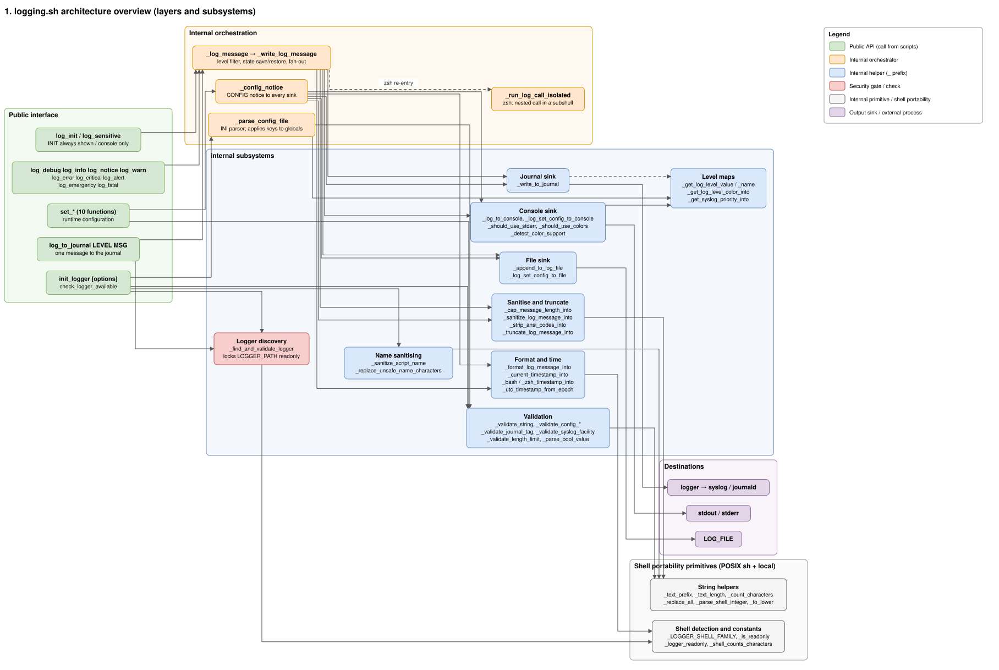
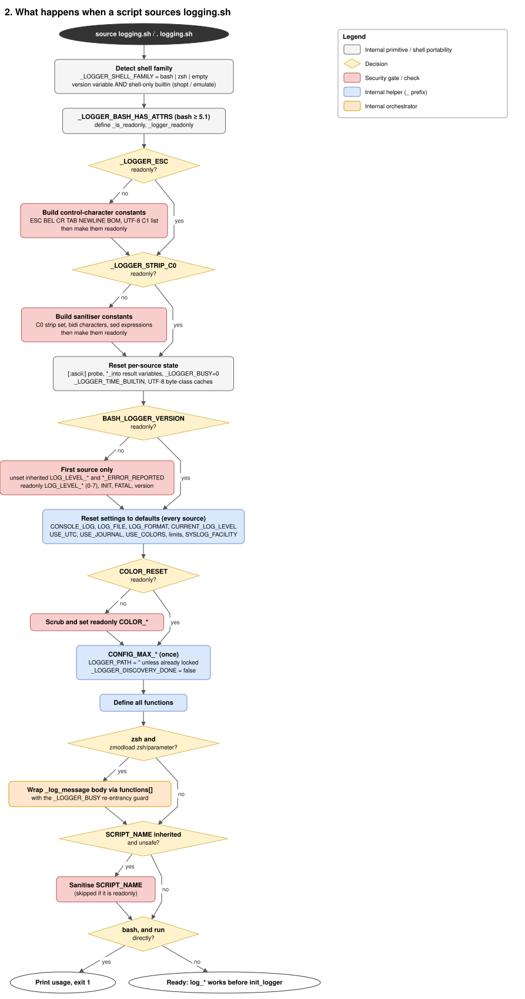
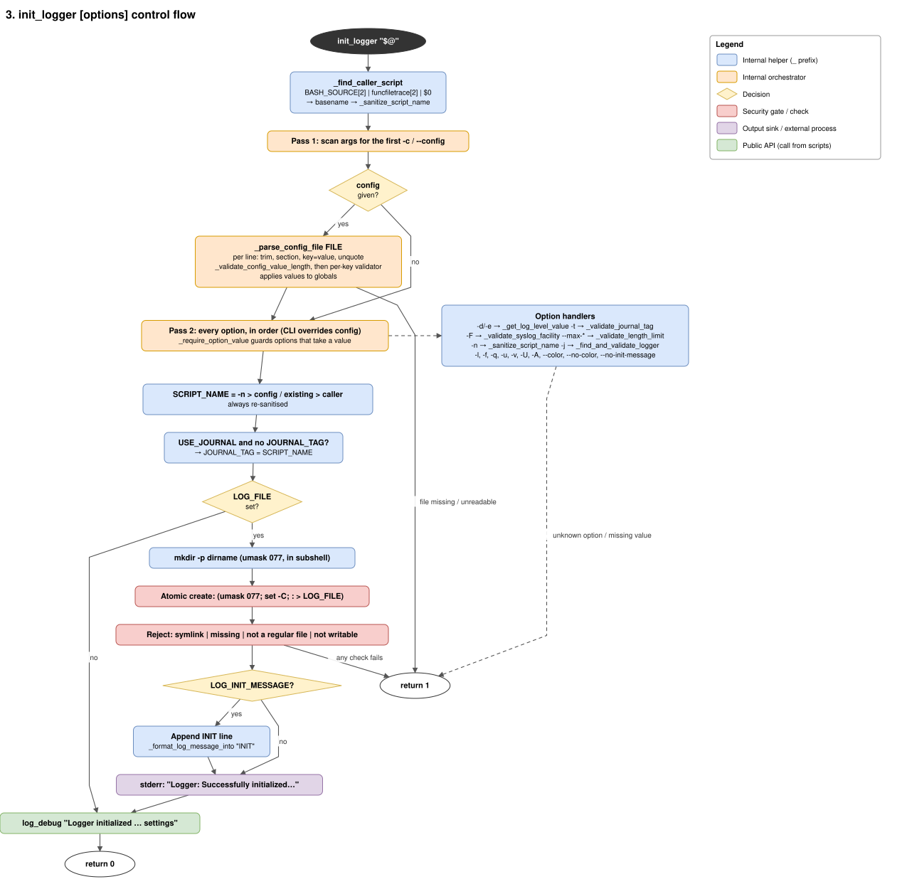
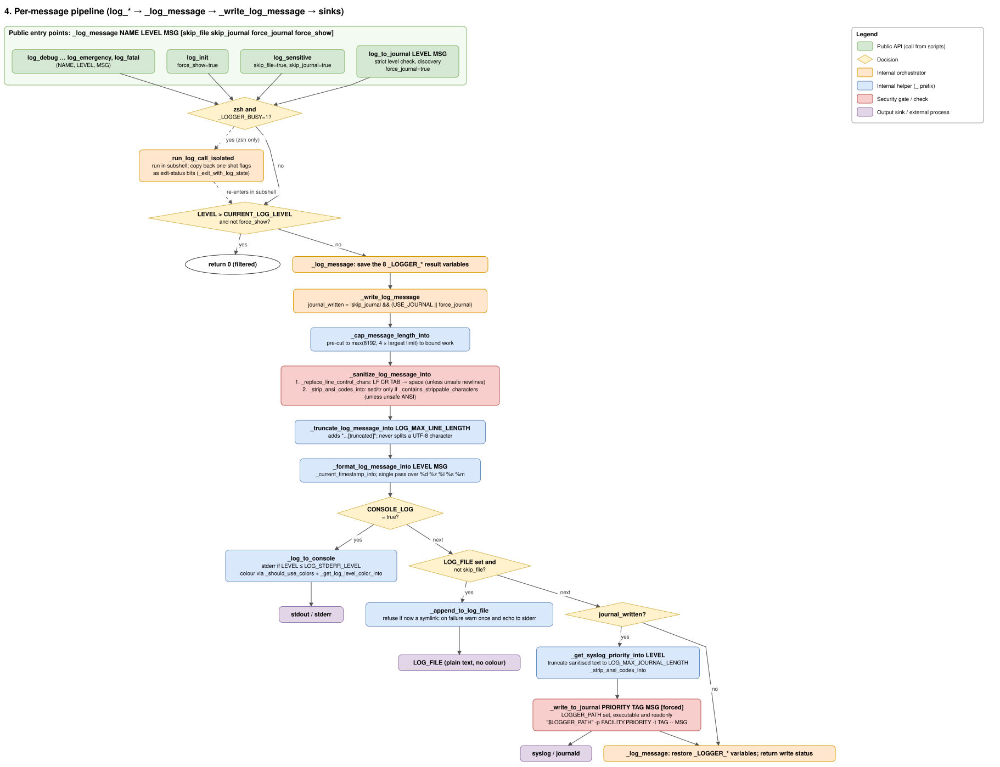
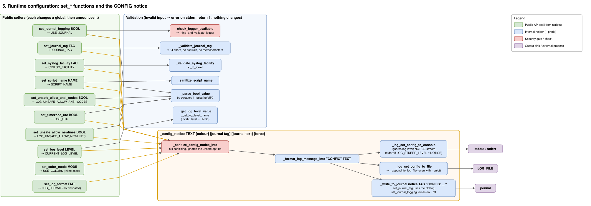
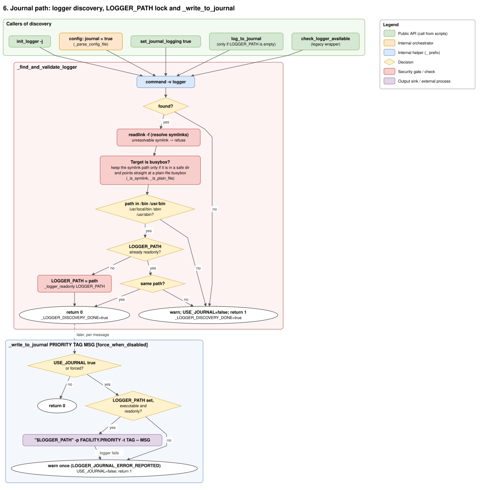
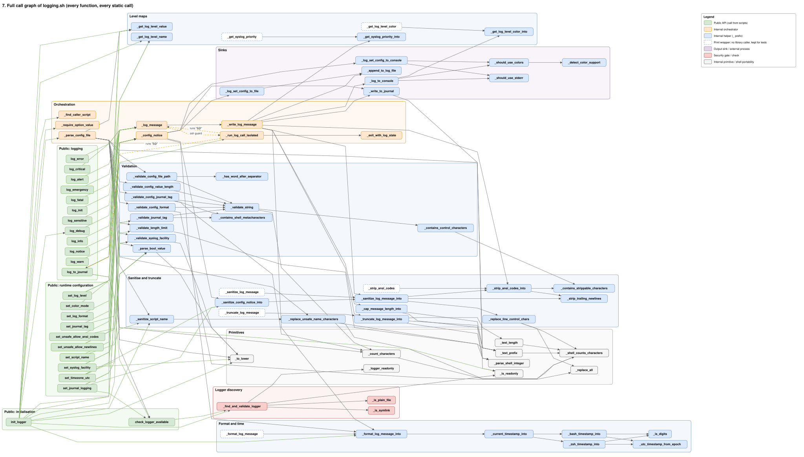

# logging.sh Architecture Reference <!-- omit in toc -->

A map of `logging.sh` for maintainers and new contributors: what each function does, which functions form the public interface, and how they call each other.

* **Source analysed:** `logging.sh` at version 3.0.3 (commit `54da855`, 3,048 lines)
* **Functions:** 90 in total: 24 public, 66 internal
* **Diagrams:** [`logging-sh-architecture.drawio`](logging-sh-architecture.drawio) has 7 pages. The SVG files in `images/` are previews of the same pages.
* **Companion document:** [Test Suite Reference](tests-reference.md)

> **Version note:** This document describes `logging.sh` as it was at **bash-logger 3.0.3**. Function names, counts, line numbers and call relationships in later releases may differ.
> When the two disagree, the code in `logging.sh` is correct.

## Table of Contents <!-- omit in toc -->

* [1. How to read this document](#1-how-to-read-this-document)
* [2. Architecture overview](#2-architecture-overview)
* [3. Public interface](#3-public-interface)
* [4. Internal API by subsystem](#4-internal-api-by-subsystem)
* [5. Lifecycle walkthroughs](#5-lifecycle-walkthroughs)
* [6. Design patterns used throughout](#6-design-patterns-used-throughout)
* [7. Global state reference](#7-global-state-reference)
* [8. Full call graph](#8-full-call-graph)
* [9. Observations](#9-observations)
* [Appendix A. Function index](#appendix-a-function-index)

## 1. How to read this document

The public/internal boundary follows the library's own rule. A name without a leading underscore is public. A name with a leading underscore is internal and may change in any release.

The diagrams use one colour scheme:

| Colour              | Meaning                                                     |
| ------------------- | ----------------------------------------------------------- |
| Green               | Public API: functions a consuming script calls              |
| Orange              | Internal orchestrator: coordinates other internals          |
| Blue                | Internal helper                                             |
| Blue, dashed border | Print wrapper: no caller inside the library, kept for tests |
| Red                 | Security gate or check                                      |
| Grey                | Shell portability primitive                                 |
| Purple              | Output destination or external process                      |
| Yellow diamond      | Decision                                                    |

Line numbers refer to `logging.sh` 3.0.3. They will drift as the file changes.

## 2. Architecture overview

`logging.sh` is one sourced file with four layers:

1. **Public interface.** `init_logger`, the eleven `log_*` functions, `log_to_journal`, `check_logger_available` and ten `set_*` functions.
2. **Orchestration.** `_log_message` and `_write_log_message` run every message. `_config_notice` runs every runtime change. `_parse_config_file` applies a config file.
   `_run_log_call_isolated` handles a nested call in zsh.
3. **Subsystems.** Validation, level mapping, sanitising and truncation, name sanitising, formatting and timestamps, the three output sinks, and logger discovery.
4. **Primitives.** Shell detection, readonly handling and string helpers that behave the same in bash 3.2+, `bash --posix`, zsh, dash and busybox ash.

The code is POSIX sh plus `local` (Issue #143). Code that only bash or zsh understands sits behind a `_LOGGER_SHELL_FAMILY` check, often inside an `eval` string so that dash does not fail to parse it.

All state is in global shell variables. There is no object or handle: a script has one logger.

## 3. Public interface

### 3.1 Initialisation

| Function                 | Arguments           | Returns                        | What it does                                                                                                         |
| ------------------------ | ------------------- | ------------------------------ | -------------------------------------------------------------------------------------------------------------------- |
| `init_logger`            | Options (table 3.4) | 0, or 1 on any error           | Applies a config file, then CLI options. Sets `SCRIPT_NAME`. Creates and checks the log file. Writes the INIT line.  |
| `check_logger_available` | None                | 0 if a trusted `logger` exists | Wrapper for `_find_and_validate_logger`. A success locks `LOGGER_PATH` readonly. A failure sets `USE_JOURNAL=false`. |

Logging works before `init_logger` is called. Sourcing the file sets usable defaults (console on, level INFO, no file, no journal).

### 3.2 Logging functions

Every function below calls `_log_message NAME LEVEL MESSAGE [skip_file] [skip_journal] [force_journal] [force_show]`.

| Function                    | Label           |     Level value | Special behaviour                                                                                                                                    |
| --------------------------- | --------------- | --------------: | ---------------------------------------------------------------------------------------------------------------------------------------------------- |
| `log_debug`                 | DEBUG           |               7 |                                                                                                                                                      |
| `log_info`                  | INFO            |               6 |                                                                                                                                                      |
| `log_notice`                | NOTICE          |               5 |                                                                                                                                                      |
| `log_warn`                  | WARN            |               4 |                                                                                                                                                      |
| `log_error`                 | ERROR           |               3 | Goes to stderr by default (`LOG_STDERR_LEVEL=3`)                                                                                                     |
| `log_critical`              | CRITICAL        |               2 |                                                                                                                                                      |
| `log_alert`                 | ALERT           |               1 |                                                                                                                                                      |
| `log_emergency`             | EMERGENCY       |               0 |                                                                                                                                                      |
| `log_fatal`                 | FATAL           |               0 | Alias of EMERGENCY with its own label                                                                                                                |
| `log_init`                  | INIT            |               6 | `force_show=true`: shown whatever the log level                                                                                                      |
| `log_sensitive`             | SENSITIVE       |               6 | `skip_file=true`, `skip_journal=true`: console only                                                                                                  |
| `log_to_journal LEVEL MSG…` | the level given | the level given | `force_journal=true`. Validates the level strictly (1 on an unknown name). Runs logger discovery if needed. Also writes to the console and the file. |

The level functions log `$1` only. `log_to_journal` joins its remaining arguments with `$*`.

### 3.3 Runtime configuration functions

Each setter validates its argument, changes one global, then calls `_config_notice`. The notice is written to the console, the log file and the journal whatever the log level.

| Function                      | Changes                       | Accepts                                                                                | Invalid input                                                            |
| ----------------------------- | ----------------------------- | -------------------------------------------------------------------------------------- | ------------------------------------------------------------------------ |
| `set_log_level`               | `CURRENT_LOG_LEVEL`           | Level name, alias or 0-7                                                               | Silently becomes INFO, returns 0                                         |
| `set_log_format`              | `LOG_FORMAT`                  | Any string                                                                             | Not validated                                                            |
| `set_timezone_utc`            | `USE_UTC`                     | true/false/yes/no/on/off/1/0                                                           | Error, return 1                                                          |
| `set_journal_logging`         | `USE_JOURNAL`                 | Boolean                                                                                | Error, return 1. Enabling without a trusted logger reverts and returns 1 |
| `set_journal_tag`             | `JOURNAL_TAG`                 | Up to 64 characters, no control or shell metacharacters                                | Rejected, return 1                                                       |
| `set_syslog_facility`         | `SYSLOG_FACILITY`             | kern, user, mail, daemon, auth, syslog, lpr, news, uucp, cron, authpriv, ftp, local0-7 | Warning, return 1                                                        |
| `set_color_mode`              | `USE_COLORS`                  | auto/always/never or a boolean                                                         | Error, return 1                                                          |
| `set_script_name`             | `SCRIPT_NAME`                 | Any string, sanitised to `[A-Za-z0-9._-]`                                              | Never rejected                                                           |
| `set_unsafe_allow_newlines`   | `LOG_UNSAFE_ALLOW_NEWLINES`   | Boolean                                                                                | Error, return 1                                                          |
| `set_unsafe_allow_ansi_codes` | `LOG_UNSAFE_ALLOW_ANSI_CODES` | Boolean                                                                                | Error, return 1                                                          |

### 3.4 One setting, three ways to set it

Most settings can come from an `init_logger` option, a config file key or a setter. Precedence at initialisation is: CLI option, then config file, then the default. A setter called
later wins over both.

| Variable                      | `init_logger` option                                  | Config keys                                                                                 | Setter                        |
| ----------------------------- | ----------------------------------------------------- | ------------------------------------------------------------------------------------------- | ----------------------------- |
| `CURRENT_LOG_LEVEL`           | `-d`/`--level`; `-v`/`--verbose`/`--debug` sets DEBUG | `level`, `log_level`; `verbose`                                                             | `set_log_level`               |
| `LOG_FORMAT`                  | `-f`/`--format`                                       | `format`, `log_format`                                                                      | `set_log_format`              |
| `LOG_FILE`                    | `-l`/`--log`/`--logfile`/`--log-file`/`--file`        | `log_file`, `logfile`, `file`                                                               | none                          |
| `USE_JOURNAL`                 | `-j`/`--journal`                                      | `journal`, `use_journal`                                                                    | `set_journal_logging`         |
| `JOURNAL_TAG`                 | `-t`/`--tag`                                          | `tag`, `journal_tag`                                                                        | `set_journal_tag`             |
| `SYSLOG_FACILITY`             | `-F`/`--facility`                                     | `facility`, `syslog_facility`                                                               | `set_syslog_facility`         |
| `USE_UTC`                     | `-u`/`--utc`                                          | `utc`, `use_utc`                                                                            | `set_timezone_utc`            |
| `USE_COLORS`                  | `--color`/`--colour`, `--no-color`/`--no-colour`      | `color`, `colour`, `colors`, `colours`, `use_colors`                                        | `set_color_mode`              |
| `LOG_STDERR_LEVEL`            | `-e`/`--stderr-level`                                 | `stderr_level`, `stderr-level`                                                              | none                          |
| `CONSOLE_LOG`                 | `-q`/`--quiet`                                        | `quiet`, `console_log`                                                                      | none                          |
| `SCRIPT_NAME`                 | `-n`/`--name`/`--script-name`                         | `script_name`, `scriptname`, `name`                                                         | `set_script_name`             |
| `LOG_UNSAFE_ALLOW_NEWLINES`   | `-U`/`--unsafe-allow-newlines`                        | `unsafe_allow_newlines`, `unsafe-allow-newlines`                                            | `set_unsafe_allow_newlines`   |
| `LOG_UNSAFE_ALLOW_ANSI_CODES` | `-A`/`--unsafe-allow-ansi-codes`                      | `unsafe_allow_ansi_codes`, `unsafe-allow-ansi-codes`                                        | `set_unsafe_allow_ansi_codes` |
| `LOG_MAX_LINE_LENGTH`         | `--max-line-length`                                   | `max_line_length`, `max-line-length`, `log_max_line_length`, `log-max-line-length`          | none                          |
| `LOG_MAX_JOURNAL_LENGTH`      | `--max-journal-length`                                | `max_journal_length`, `max-journal-length`, `journal_max_length`, `journal-max-line-length` | none                          |
| `LOG_INIT_MESSAGE`            | `--no-init-message`                                   | `init_message`, `log_init_message`                                                          | none                          |
| `LOG_CONFIG_FILE`             | `-c`/`--config`                                       | set by the parser                                                                           | none                          |

### 3.5 Public constants and variables

Readonly after the first source:

* `LOG_LEVEL_EMERGENCY`=0 … `LOG_LEVEL_DEBUG`=7, `LOG_LEVEL_FATAL`=0, `LOG_LEVEL_INIT`=6
* `COLOR_RESET`, `COLOR_BLUE`, `COLOR_GREEN`, `COLOR_YELLOW`, `COLOR_RED`, `COLOR_RED_BOLD`, `COLOR_WHITE_ON_RED`, `COLOR_BOLD_WHITE_ON_RED`, `COLOR_PURPLE`, `COLOR_CYAN`
* `BASH_LOGGER_VERSION`, `CONFIG_MAX_VALUE_LENGTH`, `CONFIG_MAX_PATH_LENGTH`
* `LOGGER_PATH`, once `_find_and_validate_logger` has validated a path

The settings variables in table 3.4 are documented as readable. Scripts and tests also assign some of them directly, `LOG_FILE` in particular. A direct assignment bypasses
validation and produces no CONFIG notice.

## 4. Internal API by subsystem

Section 8 has the full call graph. Appendix A lists every function with its callers.

### 4.1 Orchestration

| Function                 | Role                                                                                                                                                                                                    |
| ------------------------ | ------------------------------------------------------------------------------------------------------------------------------------------------------------------------------------------------------- |
| `_log_message`           | Entry for every message. Applies the level filter (unless `force_show`). Saves the eight `_LOGGER_*` result variables, calls `_write_log_message`, restores them. In zsh, a guard wraps its body (6.6). |
| `_write_log_message`     | Runs the pipeline in section 5.3 and fans out to the console, file and journal. Its status is the journal write status, or 0.                                                                           |
| `_config_notice`         | Called last by every setter. Sanitises the notice text, formats it with label CONFIG and writes it to every enabled destination.                                                                        |
| `_parse_config_file`     | Reads an INI file line by line and applies each known key to its global. Unknown keys and bad values print a warning and are skipped. Returns 1 only when the file is missing or unreadable.            |
| `_run_log_call_isolated` | zsh only: runs a nested log call in a subshell, then copies the one-shot flags back from the exit status.                                                                                               |
| `_exit_with_log_state`   | Encodes those flags into the subshell's exit status.                                                                                                                                                    |
| `_find_caller_script`    | Finds the script that called `init_logger`: `BASH_SOURCE[2]` in bash, `funcfiletrace[2]` in zsh, `$0` elsewhere. Depends on a fixed call depth.                                                         |
| `_require_option_value`  | Stops `init_logger` when an option that takes a value is the last argument.                                                                                                                             |

### 4.2 Validation

| Function                         | Role                                                                                                                                                     |
| -------------------------------- | -------------------------------------------------------------------------------------------------------------------------------------------------------- |
| `_validate_string`               | Shared check: empty (optional), maximum length in characters, control characters (optional).                                                             |
| `_validate_config_value_length`  | Length check that every config value goes through.                                                                                                       |
| `_validate_config_file_path`     | `log_file` from config: absolute path, no control characters, no command-injection patterns (`$(`, backtick, `; rm`, `; dd`, `\| sh`, `&& rm`, `&& dd`). |
| `_validate_config_format`        | Rejects a config format that has control characters once the `%` tokens are removed.                                                                     |
| `_validate_config_journal_tag`   | Config tag check. A failure leads the parser to cut and sanitise the tag instead.                                                                        |
| `_validate_journal_tag`          | Tag check for `-t` and `set_journal_tag`.                                                                                                                |
| `_validate_syslog_facility`      | Facility allow-list, case-insensitive.                                                                                                                   |
| `_validate_length_limit`         | Shared check for `--max-*-length` and the matching config keys: integer 0-1048576, read as shell arithmetic reads it (a leading 0 means octal).          |
| `_parse_bool_value`              | Maps true/yes/on/1 and false/no/off/0 to `true` or `false`.                                                                                              |
| `_contains_control_characters`   | `[[:cntrl:]]`, plus everything `_contains_strippable_characters` finds.                                                                                  |
| `_contains_shell_metacharacters` | `$` `` ` `` `;` `\|` `&` `<` `>` `(` `)` `{` `}` `[` `]` `\`.                                                                                            |
| `_has_word_after_separator`      | Replaces a regex: finds a separator followed by spaces and a word, overlaps included.                                                                    |

### 4.3 Level maps

| Function                                       | Role                                                                                                                   |
| ---------------------------------------------- | ---------------------------------------------------------------------------------------------------------------------- |
| `_get_log_level_value`                         | Name, alias or digit to 0-7. Unknown input becomes INFO; a warning is printed only when a config line number is given. |
| `_get_log_level_name`                          | 0-7 to name; anything else gives UNKNOWN.                                                                              |
| `_get_log_level_color_into`                    | Sets `_LOGGER_COLOR` for a label, INIT and SENSITIVE included.                                                         |
| `_get_syslog_priority_into`                    | Sets `_LOGGER_PRIORITY` (debug, info, notice, warning, err, crit, alert, emerg).                                       |
| `_get_log_level_color`, `_get_syslog_priority` | Print wrappers of the two above. Used only by tests.                                                                   |

### 4.4 Sanitise and truncate

| Function                                                              | Role                                                                                                                                                                                                                |
| --------------------------------------------------------------------- | ------------------------------------------------------------------------------------------------------------------------------------------------------------------------------------------------------------------- |
| `_cap_message_length_into`                                            | Cuts a message longer than max(8192, 4 × the largest limit in use) before sanitising, so the cost of sanitising stays bounded. Returns 0 if it cut.                                                                 |
| `_sanitize_log_message_into`                                          | Step 1: LF, CR and TAB become spaces (unless unsafe newlines). Step 2: `_strip_ansi_codes_into`. Optional arguments override both unsafe flags for one call.                                                        |
| `_replace_line_control_chars`                                         | Step 1 above. Uses `tr` for long text, pattern substitution in bash/zsh, and a `_replace_all` loop otherwise.                                                                                                       |
| `_strip_ansi_codes_into`                                              | Removes CSI, OSC, DCS/SOS/PM/APC sequences, any other escape, C1 controls, U+2028/2029, bidi controls and the remaining C0 controls. Starts `sed`/`tr` only when `_contains_strippable_characters` finds something. |
| `_contains_strippable_characters`                                     | In-shell check for anything the step above would remove. It decides whether a process is started at all.                                                                                                            |
| `_strip_trailing_newlines`                                            | Keeps the 2.x behaviour, when command substitution removed trailing newlines.                                                                                                                                       |
| `_truncate_log_message_into`                                          | Cuts to a limit and appends `...[truncated]`. Characters in bash/zsh, bytes elsewhere. Never splits a UTF-8 character.                                                                                              |
| `_sanitize_config_notice_into`                                        | Full sanitising for CONFIG notices, ignoring both unsafe flags.                                                                                                                                                     |
| `_sanitize_script_name`, `_replace_unsafe_name_characters`            | Replace every character outside `[A-Za-z0-9._-]` with `_`. Input is cut to 8192 characters first, and long input is handled in 256-character chunks or with one `tr`, keeping the cost linear.                      |
| `_sanitize_log_message`, `_strip_ansi_codes`, `_truncate_log_message` | Print wrappers. Used only by tests and `compat/validator_driver.sh`.                                                                                                                                                |

### 4.5 Format and time

| Function                    | Role                                                                                                                                                                                       |
| --------------------------- | ------------------------------------------------------------------------------------------------------------------------------------------------------------------------------------------ |
| `_format_log_message_into`  | One left-to-right pass over `LOG_FORMAT`. Replaces `%d`, `%z`, `%l`, `%s`, `%m`. Inserted text is never scanned again, so a message cannot inject a token. Unknown tokens stay as written. |
| `_current_timestamp_into`   | Uses the shell builtin when there is one (`_LOGGER_TIME_BUILTIN`), checks its result against `YYYY-MM-DD HH:MM:SS`, and falls back to `date`.                                              |
| `_bash_timestamp_into`      | bash 4.2+: `printf -v … '%(…)T'`.                                                                                                                                                          |
| `_zsh_timestamp_into`       | zsh prompt expansion `%D{…}` inside `eval`.                                                                                                                                                |
| `_utc_timestamp_from_epoch` | Epoch seconds to a UTC date in shell arithmetic, so `TZ` is never assigned. A readonly `TZ` would make that assignment fail.                                                               |
| `_is_digits`                | Digits-only check.                                                                                                                                                                         |
| `_format_log_message`       | Print wrapper. No callers.                                                                                                                                                                 |

### 4.6 Output sinks

| Function                     | Role                                                                                                                                                                    |
| ---------------------------- | ----------------------------------------------------------------------------------------------------------------------------------------------------------------------- |
| `_log_to_console`            | stderr when the level is at or below `LOG_STDERR_LEVEL`, otherwise stdout. Adds colour when `_should_use_colors` says so.                                               |
| `_log_set_config_to_console` | Same for CONFIG notices: uses the NOTICE stream and ignores the log level.                                                                                              |
| `_should_use_colors`         | `USE_COLORS` always/never, otherwise `_detect_color_support`.                                                                                                           |
| `_detect_color_support`      | `NO_COLOR`, `CLICOLOR`, `CLICOLOR_FORCE`, `-t 1`, `tput colors`, then `TERM`.                                                                                           |
| `_should_use_stderr`         | Level comparison against `LOG_STDERR_LEVEL`.                                                                                                                            |
| `_append_to_log_file`        | Appends one line. Refuses if the path has become a symlink. On failure, warns once and writes the line to stderr so it is not lost.                                     |
| `_log_set_config_to_file`    | Calls `_append_to_log_file` for CONFIG notices, even with `--quiet`.                                                                                                    |
| `_write_to_journal`          | Runs `"$LOGGER_PATH" -p FACILITY.PRIORITY -t TAG -- MSG` only when `LOGGER_PATH` is set, executable and readonly. On failure, warns once and turns journal logging off. |

### 4.7 Logger discovery

| Function                        | Role                                                                                                                                                                                                                              |
| ------------------------------- | --------------------------------------------------------------------------------------------------------------------------------------------------------------------------------------------------------------------------------- |
| `_find_and_validate_logger`     | `command -v logger`, resolves symlinks, special-cases a busybox applet symlink, accepts only `/bin`, `/usr/bin`, `/usr/local/bin`, `/sbin`, `/usr/sbin`, then locks `LOGGER_PATH` readonly. A later call must find the same path. |
| `_is_symlink`, `_is_plain_file` | One-line file tests. They are separate functions so that tests can replace them and exercise the busybox branch without root.                                                                                                     |

### 4.8 Primitives

| Function                   | Role                                                                                                                                                                    |
| -------------------------- | ----------------------------------------------------------------------------------------------------------------------------------------------------------------------- |
| `_is_readonly`             | Is a variable readonly? zsh: `${(tP)name}`. bash 5.1+: `${name@a}`. Other shells: try `unset` in a subshell. Accepts plain names only, because the name reaches `eval`. |
| `_logger_readonly`         | `readonly`, or `typeset -gr` in zsh. Without it, zsh makes the constants local when the file is sourced inside a function.                                              |
| `_shell_counts_characters` | True in bash and zsh. Decides between character and byte handling.                                                                                                      |
| `_count_characters`        | Character count; uses `wc -m` for non-ASCII text in byte-counting shells.                                                                                               |
| `_text_prefix`             | First N characters (bash/zsh) or bytes (others), without cutting a UTF-8 sequence. Sets `_LOGGER_PREFIX`.                                                               |
| `_text_length`             | Length counted the way `_text_prefix` counts. Sets `_LOGGER_TEXT_LENGTH`.                                                                                               |
| `_replace_all`             | Literal replace-all, the POSIX equivalent of `${text//a/b}`. Sets `_LOGGER_REPLACED`.                                                                                   |
| `_parse_shell_integer`     | Reads digits as shell arithmetic would (leading 0 means octal). Caps at 15 digits. Sets `_LOGGER_INTEGER`.                                                              |
| `_to_lower`                | ASCII lowercase with `LC_ALL=C tr`, so a Turkish locale cannot change keyword matching. Used only outside the per-message path.                                         |

## 5. Lifecycle walkthroughs

### 5.1 Sourcing the file

Sourcing does more than define functions:

* It detects the shell. A version variable alone is not trusted, because it can be inherited from the environment. The shell must also have its own builtin (`shopt` for bash, `emulate` for zsh).
* It builds the control-character and colour constants and makes them readonly, once. The guards test readonly status, not emptiness, so an environment variable cannot pre-set a constant.
* It unsets inherited `LOG_LEVEL_*`, `LOGGER_FILE_ERROR_REPORTED` and `LOGGER_JOURNAL_ERROR_REPORTED` on the first source.
* It resets every setting to its default **on every source**. Sourcing twice discards the first configuration. The test suite uses this to give each test a clean state.
* In zsh, it rewrites `_log_message` through the `functions` table to add the re-entrancy guard (6.6).
* It sanitises an inherited `SCRIPT_NAME`, which is the only setting that survives sourcing.
* In bash, it exits with a usage message if the file was run instead of sourced.

### 5.2 `init_logger`

Points worth knowing:

* Arguments are read twice. Pass 1 only looks for the first `-c`/`--config` and applies that file. Pass 2 applies every option in order. CLI options therefore override the config file.
* Unknown options and a missing option value return 1. Invalid values for `-t`, `-F` and `--max-*` print a warning and keep the current value. An invalid `-d`/`-e` level becomes INFO
  without a warning.
* The log file is created with `set -C` (noclobber) under `umask 077`, then rejected if it is a symlink, missing, not a regular file or not writable. This is the TOCTOU mitigation
  from Issues #38 and #52.
* The final `log_debug` summary only appears at DEBUG level.

### 5.3 One message

The order of operations matters:

1. **Level filter** in `_log_message`, before any other work.
2. **Cap**, then **sanitise**, then **truncate**. The cap bounds the cost of sanitising. Truncation runs on sanitised text, so the limit applies to what is written.
3. **Format** once. The console and the file get the same line; only the console adds colour.
4. **Journal** gets its own truncation (`LOG_MAX_JOURNAL_LENGTH`) of the sanitised message, without the format prefix, because syslog adds its own timestamp and tag.

`log_sensitive` sets `skip_file` and `skip_journal`, so its text only reaches the console. `_log_message` restores the result variables afterwards, so the text does not stay in shell variables either.

### 5.4 Runtime configuration

A CONFIG notice ignores the log level and `--quiet` for the file. It is always fully sanitised, even when the unsafe modes are on, because its text comes from setter arguments
rather than from a log message.

### 5.5 Journal

The first successful discovery locks `LOGGER_PATH` readonly. A later discovery must find the same path, or journal logging is turned off. `_write_to_journal` re-checks the lock
before every write and refuses any path that was assigned some other way.

`log_to_journal` retries discovery whenever `LOGGER_PATH` is empty. A `logger` installed mid-session is therefore picked up.

## 6. Design patterns used throughout

### 6.1 `_into` functions and result variables

POSIX sh has no `printf -v` and no namerefs. Returning a string with `$(…)` costs a fork, and a message goes through about ten steps. The library therefore uses a convention:

* A function ending in `_into` writes its result to a fixed global, such as `_LOGGER_TEXT`, and prints nothing.
* The caller copies the result into a `local` straight away, because the next helper overwrites it.
* The result globals are `_LOGGER_TEXT`, `_LOGGER_TIMESTAMP`, `_LOGGER_REPLACED`, `_LOGGER_PREFIX`, `_LOGGER_INTEGER`, `_LOGGER_TEXT_LENGTH`, `_LOGGER_COLOR` and `_LOGGER_PRIORITY`.
  `_log_message` saves and restores these eight. `_LOGGER_CHARACTER_COUNT` and `_LOGGER_CALLER_PATH` follow the same pattern outside the message path.

Some functions have a print twin without `_into`, for example `_sanitize_log_message`. The library never calls the twins. Tests and `tests/compat/validator_driver.sh` do, so
renaming or removing one breaks tests.

### 6.2 Readonly guards and re-sourcing

Constants are created inside `if ! _is_readonly NAME; then … fi` blocks:

* The first source creates and locks them.
* A later source skips the block instead of failing on an assignment to a readonly variable.
* Settings outside the guards are reset on every source.

### 6.3 Shell family dispatch

`_LOGGER_SHELL_FAMILY` is `bash`, `zsh` or empty. Code that needs bash or zsh syntax is either behind that check with a `# shellcheck disable=SC3xxx` comment explaining why, or
inside an `eval` string that dash never parses. `scripts/check-posix-compat.sh` (ShellCheck with `--shell=dash`) and `scripts/check-bash32-compat.sh` enforce this in pre-commit and
CI.

Character classes are written as explicit lists (`abcdefghijklmnopqrstuvwxyz…`), not ranges such as `a-z`, because a range can follow the locale's collation order.

### 6.4 Linear time on hostile input

Messages and names can come from untrusted input, so no step may take time that grows with the square of the input length:

* `_cap_message_length_into` cuts very long messages before sanitising.
* Long text goes through one `tr` or `sed` process instead of a shell loop.
* bash and zsh pattern substitution runs in 256-character chunks, because bash 3.2 is slow on long strings.
* Each `sed` expression in `_strip_ansi_codes_into` stops at the next ESC, so unterminated sequences cannot cause backtracking.

### 6.5 One-shot error flags

`LOGGER_FILE_ERROR_REPORTED` and `LOGGER_JOURNAL_ERROR_REPORTED` make a failing destination warn once instead of on every message. Sourcing clears them, so an inherited value cannot silence errors.

### 6.6 zsh re-entrancy guard

zsh 5.9 can crash when a trap handler logs while the interrupted code is already inside `_log_message`. At source time, the body of `_log_message` is wrapped:

* The first command is a `case` on `_LOGGER_BUSY`, not `[`, because `[` is one of the crash triggers.
* When busy, the nested call runs through `_run_log_call_isolated` in a subshell.
* `always { _LOGGER_BUSY=0 }` clears the flag on every exit path.
* The subshell's one-shot flags come back as exit-status bits: 1 = call failed, 2 = file error reported, 4 = journal error reported, 8 = journal turned off.

`log_to_journal` carries the same check inline. No other shell pays for any of this.

### 6.7 Test seams

Some design choices exist so the code can be tested:

* `_is_symlink` and `_is_plain_file` are separate functions so tests can override them.
* Tests replace `_find_and_validate_logger` with a stub (`_find_and_validate_logger() { return 0; }`) to simulate a present or missing `logger`.
* The print wrappers in 6.1.

## 7. Global state reference

| Variable                                                                | Set by                                   | Read by                                                     | Notes                                                             |
| ----------------------------------------------------------------------- | ---------------------------------------- | ----------------------------------------------------------- | ----------------------------------------------------------------- |
| `_LOGGER_SHELL_FAMILY`                                                  | source                                   | almost everything                                           | bash, zsh or empty                                                |
| `_LOGGER_BASH_HAS_ATTRS`                                                | source                                   | `_is_readonly`                                              | bash 5.1+                                                         |
| `_LOGGER_ASCII_CLASS`                                                   | source                                   | `_contains_strippable_characters`                           | `[:ascii:]` works                                                 |
| `_LOGGER_TIME_BUILTIN`                                                  | source                                   | `_current_timestamp_into`                                   | bash 4.2+ or zsh                                                  |
| `_LOGGER_ESC` … `_LOGGER_BOM`, `_LOGGER_UTF8_CONTROLS`                  | source, readonly                         | sanitisers, config parser, colours                          |                                                                   |
| `_LOGGER_STRIP_C0`, bidi constants, `_LOGGER_SED_STRIP_*`               | source, readonly                         | `_contains_strippable_characters`, `_strip_ansi_codes_into` |                                                                   |
| `_LOGGER_UTF8_LEAD*`, `_LOGGER_UTF8_CONTINUATION`, `_LOGGER_UTF8_PROBE` | first use                                | `_text_prefix`, `_text_length`                              | Cleared on source so the environment cannot inject `sed` commands |
| `_LOGGER_BUSY`                                                          | `_log_message` guard (zsh)               | guard, `log_to_journal`                                     |                                                                   |
| `_LOGGER_DISCOVERY_DONE`                                                | `_find_and_validate_logger`              | `log_to_journal`                                            |                                                                   |
| `LOGGER_PATH`                                                           | `_find_and_validate_logger`              | `_write_to_journal`, `log_to_journal`                       | Readonly once validated                                           |
| `LOGGER_FILE_ERROR_REPORTED`, `LOGGER_JOURNAL_ERROR_REPORTED`           | sinks                                    | sinks                                                       | One-shot flags                                                    |
| Settings in table 3.4                                                   | defaults, `init_logger`, config, setters | pipeline                                                    |                                                                   |

## 8. Full call graph

Every static call between the 90 functions. Green edges start at a public function. Dashed orange edges are the two dynamic calls a text scan cannot see: the zsh guard into
`_run_log_call_isolated`, and that function running `"$@"`.

The graph is dense. Appendix A has the same information as a table.

## 9. Observations

These came up while mapping the code. They are candidates for review, not confirmed defects, except where marked as checked.

1. **`init_logger` leaked `LOG_DIR` (fixed).** The directory of the log file is now held in a local variable, so a script's own `LOG_DIR` is left alone.
2. **Invalid level names are silently INFO (checked).** `set_log_level bogus` returns 0 and sets INFO. `init_logger -d bogus` behaves the same. A config file `level = bogus` warns.
   Every other setter rejects invalid input.
3. **Extra arguments to the level functions are dropped (checked).** `log_info first second` logs `first`. `log_to_journal` uses `$*`, so the two behave differently.
4. **`log_to_journal` writes to every destination.** It passes `force_journal=true` but not `skip_file`, so the message also reaches the console and the file. The comment "Log a
   single message directly to the system journal" could suggest journal only.
5. **Option value checks differed (fixed).** An empty value for `--name`, `--level`, `--stderr-level`, `--format`, `--tag`, `-F`, `--max-line-length` or `--max-journal-length` is now an
   error for every one of them, through `_require_nonempty_option_value`.
6. **`docs/api-reference.md` lists 11 internal functions.** There are 66. Linking this document from there would close the gap.
7. **Config key naming.** `journal-max-line-length` is the only alias that does not follow the `max_journal_length` pattern.
8. **Two journal tag validators.** `_validate_config_journal_tag` and `_validate_journal_tag` differ only in message wording and the config line number.

## Appendix A. Function index

Generated from `logging.sh` 3.0.3. "Calls" and "Called by" are static calls between functions. "Referenced in tests" counts files under `tests/` (including `tests/compat/`) that
mention a public function, and names the files for internal ones.

| Function                          | Line | Group                         | Kind          | Calls                                                                                                                                                                                                                                                                                                                                                                | Called by                                                                                                                                                                                                               | Referenced in tests                                                                                                                                                                     |
| --------------------------------- | ---: | ----------------------------- | ------------- | -------------------------------------------------------------------------------------------------------------------------------------------------------------------------------------------------------------------------------------------------------------------------------------------------------------------------------------------------------------------- | ----------------------------------------------------------------------------------------------------------------------------------------------------------------------------------------------------------------------- | --------------------------------------------------------------------------------------------------------------------------------------------------------------------------------------- |
| `init_logger`                     | 2102 | Public: initialisation        | public        | `_find_and_validate_logger`, `_find_caller_script`, `_format_log_message_into`, `_get_log_level_name`, `_get_log_level_value`, `_parse_config_file`, `_require_option_value`, `_sanitize_script_name`, `_to_lower`, `_validate_journal_tag`, `_validate_length_limit`, `_validate_syslog_facility`, `log_debug`                                                      | —                                                                                                                                                                                                                       | 49 files                                                                                                                                                                                |
| `check_logger_available`          |  915 | Public: initialisation        | public        | `_find_and_validate_logger`                                                                                                                                                                                                                                                                                                                                          | `_parse_config_file`, `set_journal_logging`, `log_to_journal`                                                                                                                                                           | 10 files                                                                                                                                                                                |
| `log_debug`                       | 2890 | Public: logging               | public        | `_log_message`                                                                                                                                                                                                                                                                                                                                                       | `init_logger`                                                                                                                                                                                                           | 11 files                                                                                                                                                                                |
| `log_info`                        | 2894 | Public: logging               | public        | `_log_message`                                                                                                                                                                                                                                                                                                                                                       | —                                                                                                                                                                                                                       | 43 files                                                                                                                                                                                |
| `log_notice`                      | 2898 | Public: logging               | public        | `_log_message`                                                                                                                                                                                                                                                                                                                                                       | —                                                                                                                                                                                                                       | 6 files                                                                                                                                                                                 |
| `log_warn`                        | 2902 | Public: logging               | public        | `_log_message`                                                                                                                                                                                                                                                                                                                                                       | —                                                                                                                                                                                                                       | 14 files                                                                                                                                                                                |
| `log_error`                       | 2906 | Public: logging               | public        | `_log_message`                                                                                                                                                                                                                                                                                                                                                       | —                                                                                                                                                                                                                       | 13 files                                                                                                                                                                                |
| `log_critical`                    | 2910 | Public: logging               | public        | `_log_message`                                                                                                                                                                                                                                                                                                                                                       | —                                                                                                                                                                                                                       | 6 files                                                                                                                                                                                 |
| `log_alert`                       | 2914 | Public: logging               | public        | `_log_message`                                                                                                                                                                                                                                                                                                                                                       | —                                                                                                                                                                                                                       | 5 files                                                                                                                                                                                 |
| `log_emergency`                   | 2918 | Public: logging               | public        | `_log_message`                                                                                                                                                                                                                                                                                                                                                       | —                                                                                                                                                                                                                       | 5 files                                                                                                                                                                                 |
| `log_fatal`                       | 2923 | Public: logging               | public        | `_log_message`                                                                                                                                                                                                                                                                                                                                                       | —                                                                                                                                                                                                                       | 4 files                                                                                                                                                                                 |
| `log_init`                        | 2927 | Public: logging               | public        | `_log_message`                                                                                                                                                                                                                                                                                                                                                       | —                                                                                                                                                                                                                       | 7 files                                                                                                                                                                                 |
| `log_sensitive`                   | 2932 | Public: logging               | public        | `_log_message`                                                                                                                                                                                                                                                                                                                                                       | —                                                                                                                                                                                                                       | 6 files                                                                                                                                                                                 |
| `log_to_journal`                  | 2949 | Public: logging               | public        | `_get_log_level_name`, `_get_log_level_value`, `_is_readonly`, `_log_message`, `_run_log_call_isolated`, `check_logger_available`                                                                                                                                                                                                                                    | —                                                                                                                                                                                                                       | 6 files                                                                                                                                                                                 |
| `set_log_level`                   | 2437 | Public: runtime configuration | public        | `_config_notice`, `_get_log_level_name`, `_get_log_level_value`                                                                                                                                                                                                                                                                                                      | —                                                                                                                                                                                                                       | 6 files                                                                                                                                                                                 |
| `set_log_format`                  | 2466 | Public: runtime configuration | public        | `_config_notice`                                                                                                                                                                                                                                                                                                                                                     | —                                                                                                                                                                                                                       | 7 files                                                                                                                                                                                 |
| `set_timezone_utc`                | 2450 | Public: runtime configuration | public        | `_config_notice`, `_parse_bool_value`, `_sanitize_config_notice_into`                                                                                                                                                                                                                                                                                                | —                                                                                                                                                                                                                       | 5 files                                                                                                                                                                                 |
| `set_journal_logging`             | 2475 | Public: runtime configuration | public        | `_config_notice`, `_parse_bool_value`, `_sanitize_config_notice_into`, `check_logger_available`                                                                                                                                                                                                                                                                      | —                                                                                                                                                                                                                       | 6 files                                                                                                                                                                                 |
| `set_journal_tag`                 | 2507 | Public: runtime configuration | public        | `_config_notice`, `_validate_journal_tag`                                                                                                                                                                                                                                                                                                                            | —                                                                                                                                                                                                                       | 5 files                                                                                                                                                                                 |
| `set_syslog_facility`             | 2522 | Public: runtime configuration | public        | `_config_notice`, `_to_lower`, `_validate_syslog_facility`                                                                                                                                                                                                                                                                                                           | —                                                                                                                                                                                                                       | 3 files                                                                                                                                                                                 |
| `set_color_mode`                  | 2536 | Public: runtime configuration | public        | `_config_notice`                                                                                                                                                                                                                                                                                                                                                     | —                                                                                                                                                                                                                       | 6 files                                                                                                                                                                                 |
| `set_script_name`                 | 2565 | Public: runtime configuration | public        | `_config_notice`, `_sanitize_script_name`                                                                                                                                                                                                                                                                                                                            | —                                                                                                                                                                                                                       | 7 files                                                                                                                                                                                 |
| `set_unsafe_allow_newlines`       | 2577 | Public: runtime configuration | public        | `_config_notice`, `_parse_bool_value`                                                                                                                                                                                                                                                                                                                                | —                                                                                                                                                                                                                       | 9 files                                                                                                                                                                                 |
| `set_unsafe_allow_ansi_codes`     | 2605 | Public: runtime configuration | public        | `_config_notice`, `_parse_bool_value`                                                                                                                                                                                                                                                                                                                                | —                                                                                                                                                                                                                       | 8 files                                                                                                                                                                                 |
| `_log_message`                    | 2740 | Orchestration                 | internal      | `_write_log_message`                                                                                                                                                                                                                                                                                                                                                 | `log_debug`, `log_info`, `log_notice`, `log_warn`, `log_error`, `log_critical`, `log_alert`, `log_emergency`, `log_fatal`, `log_init`, `log_sensitive`, `log_to_journal`, `_run_log_call_isolated` (zsh guard)          | `scripts/stress-zsh-signals.sh`, `test_bench_script.sh`, `test_concurrent_access.sh`, `test_journal_logging.sh`, `test_posix_compat.sh`, `test_sensitive_data.sh`, `test_zsh_compat.sh` |
| `_write_log_message`              | 2816 | Orchestration                 | internal      | `_append_to_log_file`, `_cap_message_length_into`, `_format_log_message_into`, `_get_syslog_priority_into`, `_log_to_console`, `_sanitize_log_message_into`, `_strip_ansi_codes_into`, `_truncate_log_message_into`, `_write_to_journal`                                                                                                                             | `_log_message`                                                                                                                                                                                                          | `test_zsh_compat.sh`                                                                                                                                                                    |
| `_config_notice`                  | 2415 | Orchestration                 | internal      | `_format_log_message_into`, `_log_set_config_to_console`, `_log_set_config_to_file`, `_sanitize_config_notice_into`, `_write_to_journal`                                                                                                                                                                                                                             | `set_log_level`, `set_timezone_utc`, `set_log_format`, `set_journal_logging`, `set_journal_tag`, `set_syslog_facility`, `set_color_mode`, `set_script_name`, `set_unsafe_allow_newlines`, `set_unsafe_allow_ansi_codes` | —                                                                                                                                                                                       |
| `_parse_config_file`              | 1160 | Orchestration                 | internal      | `_count_characters`, `_get_log_level_value`, `_parse_bool_value`, `_replace_unsafe_name_characters`, `_sanitize_script_name`, `_text_prefix`, `_to_lower`, `_validate_config_file_path`, `_validate_config_format`, `_validate_config_journal_tag`, `_validate_config_value_length`, `_validate_length_limit`, `_validate_syslog_facility`, `check_logger_available` | `init_logger`                                                                                                                                                                                                           | `compat/validator_driver.sh`, `test_environment_security.sh`                                                                                                                            |
| `_run_log_call_isolated`          | 2716 | Orchestration                 | internal      | `_exit_with_log_state`, "$@" (_log_message, log_to_journal)                                                                                                                                                                                                                                                                                                          | `log_to_journal`, `_log_message` (zsh guard)                                                                                                                                                                            | —                                                                                                                                                                                       |
| `_exit_with_log_state`            | 2691 | Orchestration                 | internal      | —                                                                                                                                                                                                                                                                                                                                                                    | `_run_log_call_isolated`                                                                                                                                                                                                | —                                                                                                                                                                                       |
| `_find_caller_script`             | 2064 | Orchestration                 | internal      | —                                                                                                                                                                                                                                                                                                                                                                    | `init_logger`                                                                                                                                                                                                           | —                                                                                                                                                                                       |
| `_require_option_value`           | 2093 | Orchestration                 | internal      | —                                                                                                                                                                                                                                                                                                                                                                    | `init_logger`                                                                                                                                                                                                           | —                                                                                                                                                                                       |
| `_validate_string`                |  925 | Validation                    | internal      | `_contains_control_characters`, `_count_characters`                                                                                                                                                                                                                                                                                                                  | `_validate_config_value_length`, `_validate_config_file_path`, `_validate_config_format`, `_validate_config_journal_tag`, `_validate_journal_tag`                                                                       | `compat/validator_driver.sh`                                                                                                                                                            |
| `_validate_config_value_length`   |  957 | Validation                    | internal      | `_validate_string`                                                                                                                                                                                                                                                                                                                                                   | `_parse_config_file`                                                                                                                                                                                                    | —                                                                                                                                                                                       |
| `_validate_config_file_path`      |  974 | Validation                    | internal      | `_has_word_after_separator`, `_validate_string`                                                                                                                                                                                                                                                                                                                      | `_parse_config_file`                                                                                                                                                                                                    | `compat/validator_driver.sh`, `test_posix_compat.sh`                                                                                                                                    |
| `_validate_config_format`         | 1027 | Validation                    | internal      | `_replace_all`, `_validate_string`                                                                                                                                                                                                                                                                                                                                   | `_parse_config_file`                                                                                                                                                                                                    | `compat/validator_driver.sh`                                                                                                                                                            |
| `_validate_config_journal_tag`    | 1058 | Validation                    | internal      | `_contains_shell_metacharacters`, `_count_characters`, `_validate_string`                                                                                                                                                                                                                                                                                            | `_parse_config_file`                                                                                                                                                                                                    | `compat/validator_driver.sh`                                                                                                                                                            |
| `_validate_journal_tag`           | 1090 | Validation                    | internal      | `_contains_shell_metacharacters`, `_validate_string`                                                                                                                                                                                                                                                                                                                 | `init_logger`, `set_journal_tag`                                                                                                                                                                                        | `compat/validator_driver.sh`                                                                                                                                                            |
| `_validate_syslog_facility`       | 1124 | Validation                    | internal      | `_to_lower`                                                                                                                                                                                                                                                                                                                                                          | `_parse_config_file`, `init_logger`, `set_syslog_facility`                                                                                                                                                              | —                                                                                                                                                                                       |
| `_validate_length_limit`          |  509 | Validation                    | internal      | `_parse_shell_integer`                                                                                                                                                                                                                                                                                                                                               | `_parse_config_file`, `init_logger`                                                                                                                                                                                     | —                                                                                                                                                                                       |
| `_parse_bool_value`               | 1146 | Validation                    | internal      | `_to_lower`                                                                                                                                                                                                                                                                                                                                                          | `_parse_config_file`, `set_timezone_utc`, `set_journal_logging`, `set_unsafe_allow_newlines`, `set_unsafe_allow_ansi_codes`                                                                                             | —                                                                                                                                                                                       |
| `_contains_control_characters`    |  330 | Validation                    | internal      | `_contains_strippable_characters`                                                                                                                                                                                                                                                                                                                                    | `_validate_string`                                                                                                                                                                                                      | —                                                                                                                                                                                       |
| `_contains_shell_metacharacters`  |  339 | Validation                    | internal      | —                                                                                                                                                                                                                                                                                                                                                                    | `_validate_config_journal_tag`, `_validate_journal_tag`                                                                                                                                                                 | —                                                                                                                                                                                       |
| `_has_word_after_separator`       |  353 | Validation                    | internal      | —                                                                                                                                                                                                                                                                                                                                                                    | `_validate_config_file_path`                                                                                                                                                                                            | —                                                                                                                                                                                       |
| `_get_log_level_value`            | 1460 | Level maps                    | internal      | —                                                                                                                                                                                                                                                                                                                                                                    | `_parse_config_file`, `init_logger`, `set_log_level`, `log_to_journal`                                                                                                                                                  | `compat/validator_driver.sh`, `test_log_levels.sh`                                                                                                                                      |
| `_get_log_level_name`             | 1507 | Level maps                    | internal      | —                                                                                                                                                                                                                                                                                                                                                                    | `init_logger`, `set_log_level`, `log_to_journal`                                                                                                                                                                        | `test_edge_cases.sh`, `test_log_levels.sh`                                                                                                                                              |
| `_get_log_level_color`            | 1541 | Level maps                    | print wrapper | `_get_log_level_color_into`                                                                                                                                                                                                                                                                                                                                          | —                                                                                                                                                                                                                       | `test_edge_cases.sh`                                                                                                                                                                    |
| `_get_log_level_color_into`       | 1547 | Level maps                    | internal      | —                                                                                                                                                                                                                                                                                                                                                                    | `_get_log_level_color`, `_log_to_console`                                                                                                                                                                               | —                                                                                                                                                                                       |
| `_get_syslog_priority`            | 1564 | Level maps                    | print wrapper | `_get_syslog_priority_into`                                                                                                                                                                                                                                                                                                                                          | —                                                                                                                                                                                                                       | `test_edge_cases.sh`, `test_log_levels.sh`                                                                                                                                              |
| `_get_syslog_priority_into`       | 1570 | Level maps                    | internal      | —                                                                                                                                                                                                                                                                                                                                                                    | `_get_syslog_priority`, `_write_log_message`                                                                                                                                                                            | —                                                                                                                                                                                       |
| `_cap_message_length_into`        | 1835 | Sanitise and truncate         | internal      | `_parse_shell_integer`, `_text_prefix`                                                                                                                                                                                                                                                                                                                               | `_write_log_message`                                                                                                                                                                                                    | —                                                                                                                                                                                       |
| `_sanitize_log_message`           | 1797 | Sanitise and truncate         | print wrapper | `_sanitize_log_message_into`                                                                                                                                                                                                                                                                                                                                         | —                                                                                                                                                                                                                       | `test_ansi_injection.sh`, `test_mixed_sanitization_modes.sh`, `test_unsafe_newlines.sh`                                                                                                 |
| `_sanitize_log_message_into`      | 1804 | Sanitise and truncate         | internal      | `_replace_line_control_chars`, `_strip_ansi_codes_into`, `_strip_trailing_newlines`                                                                                                                                                                                                                                                                                  | `_sanitize_log_message`, `_sanitize_config_notice_into`, `_write_log_message`                                                                                                                                           | —                                                                                                                                                                                       |
| `_sanitize_config_notice_into`    | 2401 | Sanitise and truncate         | internal      | `_sanitize_log_message_into`                                                                                                                                                                                                                                                                                                                                         | `_config_notice`, `set_timezone_utc`, `set_journal_logging`                                                                                                                                                             | —                                                                                                                                                                                       |
| `_replace_line_control_chars`     | 1760 | Sanitise and truncate         | internal      | `_replace_all`, `_shell_counts_characters`                                                                                                                                                                                                                                                                                                                           | `_sanitize_log_message_into`                                                                                                                                                                                            | —                                                                                                                                                                                       |
| `_strip_ansi_codes`               | 1685 | Sanitise and truncate         | print wrapper | `_strip_ansi_codes_into`                                                                                                                                                                                                                                                                                                                                             | —                                                                                                                                                                                                                       | `test_ansi_injection.sh`                                                                                                                                                                |
| `_strip_ansi_codes_into`          | 1694 | Sanitise and truncate         | internal      | `_contains_strippable_characters`, `_strip_trailing_newlines`                                                                                                                                                                                                                                                                                                        | `_strip_ansi_codes`, `_sanitize_log_message_into`, `_write_log_message`                                                                                                                                                 | —                                                                                                                                                                                       |
| `_contains_strippable_characters` | 1633 | Sanitise and truncate         | internal      | —                                                                                                                                                                                                                                                                                                                                                                    | `_contains_control_characters`, `_strip_ansi_codes_into`                                                                                                                                                                | —                                                                                                                                                                                       |
| `_strip_trailing_newlines`        |  587 | Sanitise and truncate         | internal      | —                                                                                                                                                                                                                                                                                                                                                                    | `_strip_ansi_codes_into`, `_sanitize_log_message_into`                                                                                                                                                                  | —                                                                                                                                                                                       |
| `_truncate_log_message`           | 1869 | Sanitise and truncate         | print wrapper | `_truncate_log_message_into`                                                                                                                                                                                                                                                                                                                                         | —                                                                                                                                                                                                                       | `compat/validator_driver.sh`                                                                                                                                                            |
| `_truncate_log_message_into`      | 1880 | Sanitise and truncate         | internal      | `_parse_shell_integer`, `_text_length`, `_text_prefix`                                                                                                                                                                                                                                                                                                               | `_truncate_log_message`, `_write_log_message`                                                                                                                                                                           | —                                                                                                                                                                                       |
| `_sanitize_script_name`           | 1919 | Sanitise and truncate         | internal      | `_replace_unsafe_name_characters`                                                                                                                                                                                                                                                                                                                                    | `_parse_config_file`, `init_logger`, `set_script_name`                                                                                                                                                                  | `compat/validator_driver.sh`, `test_script_name_sanitization.sh`                                                                                                                        |
| `_replace_unsafe_name_characters` |  415 | Sanitise and truncate         | internal      | `_shell_counts_characters`, `_text_prefix`                                                                                                                                                                                                                                                                                                                           | `_parse_config_file`, `_sanitize_script_name`                                                                                                                                                                           | —                                                                                                                                                                                       |
| `_format_log_message`             | 1927 | Format and time               | print wrapper | `_format_log_message_into`                                                                                                                                                                                                                                                                                                                                           | —                                                                                                                                                                                                                       | —                                                                                                                                                                                       |
| `_format_log_message_into`        | 2012 | Format and time               | internal      | `_current_timestamp_into`                                                                                                                                                                                                                                                                                                                                            | `_format_log_message`, `init_logger`, `_config_notice`, `_write_log_message`                                                                                                                                            | —                                                                                                                                                                                       |
| `_current_timestamp_into`         | 1935 | Format and time               | internal      | `_bash_timestamp_into`, `_zsh_timestamp_into`                                                                                                                                                                                                                                                                                                                        | `_format_log_message_into`                                                                                                                                                                                              | —                                                                                                                                                                                       |
| `_bash_timestamp_into`            | 1979 | Format and time               | internal      | `_is_digits`, `_utc_timestamp_from_epoch`                                                                                                                                                                                                                                                                                                                            | `_current_timestamp_into`                                                                                                                                                                                               | —                                                                                                                                                                                       |
| `_zsh_timestamp_into`             | 1997 | Format and time               | internal      | `_is_digits`, `_utc_timestamp_from_epoch`                                                                                                                                                                                                                                                                                                                            | `_current_timestamp_into`                                                                                                                                                                                               | —                                                                                                                                                                                       |
| `_utc_timestamp_from_epoch`       | 1955 | Format and time               | internal      | —                                                                                                                                                                                                                                                                                                                                                                    | `_bash_timestamp_into`, `_zsh_timestamp_into`                                                                                                                                                                           | `test_posix_compat.sh`                                                                                                                                                                  |
| `_is_digits`                      | 2082 | Format and time               | internal      | —                                                                                                                                                                                                                                                                                                                                                                    | `_bash_timestamp_into`, `_zsh_timestamp_into`                                                                                                                                                                           | —                                                                                                                                                                                       |
| `_log_to_console`                 | 2631 | Sinks                         | internal      | `_get_log_level_color_into`, `_should_use_colors`, `_should_use_stderr`                                                                                                                                                                                                                                                                                              | `_write_log_message`                                                                                                                                                                                                    | —                                                                                                                                                                                       |
| `_log_set_config_to_console`      | 2364 | Sinks                         | internal      | `_should_use_colors`, `_should_use_stderr`                                                                                                                                                                                                                                                                                                                           | `_config_notice`                                                                                                                                                                                                        | —                                                                                                                                                                                       |
| `_should_use_colors`              |  765 | Sinks                         | internal      | `_detect_color_support`                                                                                                                                                                                                                                                                                                                                              | `_log_set_config_to_console`, `_log_to_console`                                                                                                                                                                         | —                                                                                                                                                                                       |
| `_detect_color_support`           |  724 | Sinks                         | internal      | —                                                                                                                                                                                                                                                                                                                                                                    | `_should_use_colors`                                                                                                                                                                                                    | `test_edge_cases.sh`                                                                                                                                                                    |
| `_should_use_stderr`              |  782 | Sinks                         | internal      | —                                                                                                                                                                                                                                                                                                                                                                    | `_log_set_config_to_console`, `_log_to_console`                                                                                                                                                                         | —                                                                                                                                                                                       |
| `_append_to_log_file`             | 2661 | Sinks                         | internal      | —                                                                                                                                                                                                                                                                                                                                                                    | `_log_set_config_to_file`, `_write_log_message`                                                                                                                                                                         | —                                                                                                                                                                                       |
| `_log_set_config_to_file`         | 2389 | Sinks                         | internal      | `_append_to_log_file`                                                                                                                                                                                                                                                                                                                                                | `_config_notice`                                                                                                                                                                                                        | —                                                                                                                                                                                       |
| `_write_to_journal`               | 1586 | Sinks                         | internal      | `_is_readonly`                                                                                                                                                                                                                                                                                                                                                       | `_config_notice`, `_write_log_message`                                                                                                                                                                                  | `test_journal_logging.sh`                                                                                                                                                               |
| `_find_and_validate_logger`       |  816 | Logger discovery              | internal      | `_is_plain_file`, `_is_readonly`, `_is_symlink`, `_logger_readonly`                                                                                                                                                                                                                                                                                                  | `check_logger_available`, `init_logger`                                                                                                                                                                                 | `test_environment_security.sh`, `test_format.sh`, `test_journal_logging.sh`, `test_runtime_config.sh`                                                                                   |
| `_is_symlink`                     |  804 | Logger discovery              | internal      | —                                                                                                                                                                                                                                                                                                                                                                    | `_find_and_validate_logger`                                                                                                                                                                                             | `test_posix_compat.sh`                                                                                                                                                                  |
| `_is_plain_file`                  |  809 | Logger discovery              | internal      | —                                                                                                                                                                                                                                                                                                                                                                    | `_find_and_validate_logger`                                                                                                                                                                                             | `test_posix_compat.sh`                                                                                                                                                                  |
| `_is_readonly`                    |  101 | Primitives                    | internal      | —                                                                                                                                                                                                                                                                                                                                                                    | `_find_and_validate_logger`, `_write_to_journal`, `log_to_journal`                                                                                                                                                      | `compat/scenarios/resource.sh`, `test_posix_compat.sh`, `test_source_guard.sh`                                                                                                          |
| `_logger_readonly`                |  149 | Primitives                    | internal      | —                                                                                                                                                                                                                                                                                                                                                                    | `_find_and_validate_logger`                                                                                                                                                                                             | —                                                                                                                                                                                       |
| `_shell_counts_characters`        |  298 | Primitives                    | internal      | —                                                                                                                                                                                                                                                                                                                                                                    | `_count_characters`, `_replace_unsafe_name_characters`, `_text_prefix`, `_text_length`, `_replace_line_control_chars`                                                                                                   | —                                                                                                                                                                                       |
| `_count_characters`               |  306 | Primitives                    | internal      | `_shell_counts_characters`                                                                                                                                                                                                                                                                                                                                           | `_validate_string`, `_validate_config_journal_tag`, `_parse_config_file`                                                                                                                                                | —                                                                                                                                                                                       |
| `_text_prefix`                    |  522 | Primitives                    | internal      | `_shell_counts_characters`                                                                                                                                                                                                                                                                                                                                           | `_replace_unsafe_name_characters`, `_parse_config_file`, `_cap_message_length_into`, `_truncate_log_message_into`                                                                                                       | —                                                                                                                                                                                       |
| `_text_length`                    |  554 | Primitives                    | internal      | `_shell_counts_characters`                                                                                                                                                                                                                                                                                                                                           | `_truncate_log_message_into`                                                                                                                                                                                            | `test_posix_compat.sh`                                                                                                                                                                  |
| `_replace_all`                    |  380 | Primitives                    | internal      | —                                                                                                                                                                                                                                                                                                                                                                    | `_validate_config_format`, `_replace_line_control_chars`                                                                                                                                                                | —                                                                                                                                                                                       |
| `_parse_shell_integer`            |  466 | Primitives                    | internal      | —                                                                                                                                                                                                                                                                                                                                                                    | `_validate_length_limit`, `_cap_message_length_into`, `_truncate_log_message_into`                                                                                                                                      | —                                                                                                                                                                                       |
| `_to_lower`                       | 1118 | Primitives                    | internal      | —                                                                                                                                                                                                                                                                                                                                                                    | `_validate_syslog_facility`, `_parse_bool_value`, `_parse_config_file`, `init_logger`, `set_syslog_facility`                                                                                                            | `test_config.sh`                                                                                                                                                                        |
