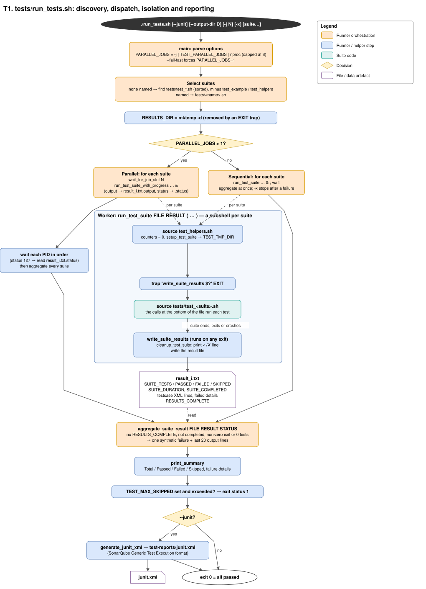
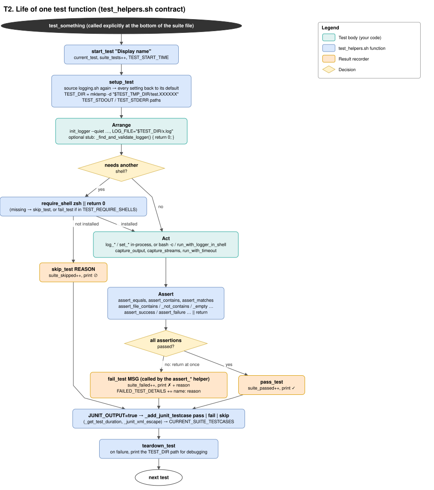
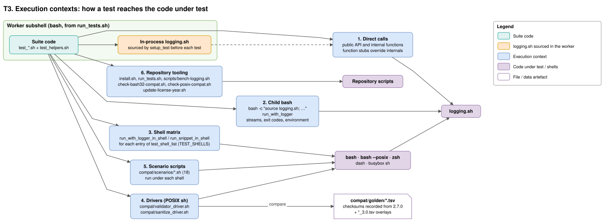
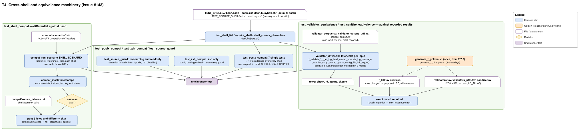
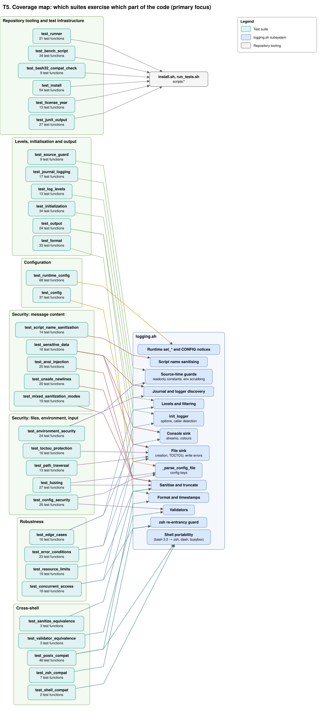
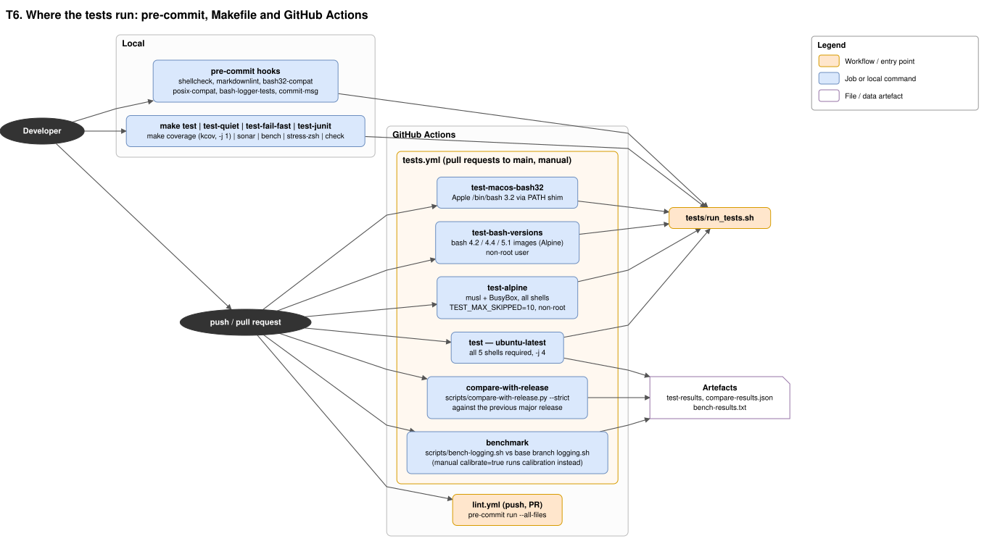

# Test Suite Reference <!-- omit in toc -->

A map of the bash-logger test suite: how the runner works, the contract every test follows, how tests reach `logging.sh`, what each suite covers, and how the cross-shell machinery fits together.

* **Source analysed:** `tests/` at version 3.0.3 (commit `54da855`)
* **Size:** 33 runnable suites, 732 test functions, about 22,000 lines including `test_helpers.sh`, `run_tests.sh` and the template
* **Diagrams:** [`tests-architecture.drawio`](tests-architecture.drawio) has 6 pages. The SVG files in `images/` are previews of the same pages.
* **Companion document:** [logging.sh Architecture Reference](logging-sh-reference.md)
* **Contributor guides already in the repo:** [docs/testing.md](../docs/testing.md) and [docs/writing-tests.md](../docs/writing-tests.md). This document explains the structure; those
  explain the day-to-day workflow.

> **Version note:** This document describes the test suite as it was at **bash-logger 3.0.3**. Suite names, test counts, run results and file contents in later releases may differ.
> When the two disagree, the code in `tests/` is correct.

## Table of Contents <!-- omit in toc -->

* [1. The test suite at a glance](#1-the-test-suite-at-a-glance)
* [2. The runner: run\_tests.sh](#2-the-runner-run_testssh)
* [3. The helper library: test\_helpers.sh](#3-the-helper-library-test_helperssh)
* [4. The life of one test](#4-the-life-of-one-test)
* [5. Execution contexts](#5-execution-contexts)
* [6. Suite catalogue](#6-suite-catalogue)
* [7. Cross-shell and equivalence machinery](#7-cross-shell-and-equivalence-machinery)
* [8. Coverage map](#8-coverage-map)
* [9. Where the tests run](#9-where-the-tests-run)
* [10. Coupling to internal functions](#10-coupling-to-internal-functions)
* [11. Observations](#11-observations)

## 1. The test suite at a glance

The framework is custom and written in bash. There is no bats or shunit2 dependency.

* `tests/run_tests.sh` finds the suites, runs each in an isolated subshell (in parallel by default), and adds up the results.
* `tests/test_helpers.sh` provides the test lifecycle (`start_test`, `pass_test`, `fail_test`, `skip_test`), assertions and shell helpers.
* Each `tests/test_*.sh` file is one suite: a set of `test_*` functions, called explicitly at the bottom of the file.
* `tests/compat/` holds the cross-shell scenarios, the POSIX sh drivers and the recorded (golden) results.

The test runner always runs under bash. The library under test runs under bash 3.2+, `bash --posix`, zsh, dash and busybox ash, depending on the suite and on `TEST_SHELLS`.

The number of results depends on `TEST_SHELLS`, because some tests run once per shell. Two runs for reference:

| Run                                                                             | Results | Passed | Failed | Skipped |
| ------------------------------------------------------------------------------- | ------: | -----: | -----: | ------: |
| Non-root, `TEST_SHELLS="bash,bash --posix,dash"`, zsh and busybox not installed |     887 |    860 |      0 |      27 |
| As root, default `TEST_SHELLS` (bash only)                                      |     751 |    713 |     11 |      27 |

The 11 failures as root are expected. Permission tests in `test_path_traversal`, `test_toctou_protection`, `test_error_conditions`, `test_config`, `test_config_security` and
`test_environment_security` cannot fail a write when root can write anywhere. CI runs container jobs as a non-root user for this reason. Run the suite as a normal user, including
inside containers.

## 2. The runner: run_tests.sh



### 2.1 Functions

| Function                                  | Role                                                                                                                                                                                                    |
| ----------------------------------------- | ------------------------------------------------------------------------------------------------------------------------------------------------------------------------------------------------------- |
| `main`                                    | Parses `--junit`, `--output-dir`, `-j`/`--parallel`, `-x`/`--fail-fast`, `--help` and suite names. Finds the suites, dispatches them, prints the summary, applies `TEST_MAX_SKIPPED`, writes JUnit XML. |
| `run_test_suite`                          | The worker. A function whose body is a `( … )` subshell, so a suite cannot change the runner's shell options or exit the runner. Sources `test_helpers.sh` and then the suite.                          |
| `run_test_suite_with_progress`            | Parallel mode wrapper: captures the worker's output, records its exit status in `result_N.txt.status`, prints a "Finished" line.                                                                        |
| `write_suite_results`                     | Installed as the worker's `EXIT` trap, so results are written even when a suite calls `exit` or hits `set -u`.                                                                                          |
| `aggregate_suite_result`                  | Reads one result file and adds it to the totals. Turns an incomplete, crashed, non-zero or empty suite into one synthetic failure with the last 20 lines of output.                                     |
| `wait_for_job_slot`                       | Waits while `N` background jobs are running.                                                                                                                                                            |
| `print_summary`                           | Prints the totals and the failure details; returns 1 if anything failed.                                                                                                                                |
| `generate_junit_xml`, `runner_xml_escape` | Write `test-reports/junit.xml` in SonarQube's Generic Test Execution format.                                                                                                                            |
| `print_banner`                            | Header text.                                                                                                                                                                                            |

### 2.2 The result file protocol

Each worker writes `RESULTS_DIR/result_N.txt`. The runner never reads a worker's variables, only this file:

```text
SUITE_TESTS=…
SUITE_PASSED=…
SUITE_FAILED=…
SUITE_SKIPPED=…
SUITE_DURATION=…
SUITE_COMPLETED=true|false
SUITE_TESTCASES_START
<testCase …/>|<testCase …/>|…
SUITE_TESTCASES_END
FAILED_DETAILS_START
<test name>: <reason>
FAILED_DETAILS_END
RESULTS_COMPLETE
```

`RESULTS_COMPLETE` is the last line. A file without it is treated as interrupted, and its partial numbers are discarded.

### 2.3 Environment variables

| Variable                       | Effect                                                                                                                                       |
| ------------------------------ | -------------------------------------------------------------------------------------------------------------------------------------------- |
| `TEST_PARALLEL_JOBS`           | Parallel jobs when `-j` is not given. Default: CPU count. Capped at 8.                                                                       |
| `TEST_SHELLS`                  | Shells for the cross-shell suites. Commas separate commands that contain spaces: `"bash,bash --posix,zsh,dash,busybox sh"`. Default: `bash`. |
| `TEST_REQUIRE_SHELLS`          | Space-separated shells that must be installed. A missing one fails instead of skipping.                                                      |
| `TEST_MAX_SKIPPED`             | Fail the run if more tests than this are skipped (Issue #152).                                                                               |
| `JUNIT_OUTPUT`                 | Set by `--junit`; makes the helpers record testcase XML.                                                                                     |
| `PROJECT_ROOT`, `SCRIPT_DIR`   | Exported by the runner for suites to use.                                                                                                    |
| `BASH_LOGGER_TEST_DISK_STRESS` | Enables the disk stress test in `test_resource_limits`.                                                                                      |

## 3. The helper library: test_helpers.sh

Sourcing it resets the suite counters and calls `setup_test_suite`, which creates `TEST_TMP_DIR`.

| Group                     | Functions                                                                                                                                        |
| ------------------------- | ------------------------------------------------------------------------------------------------------------------------------------------------ |
| Suite lifecycle           | `setup_test_suite`, `cleanup_test_suite`                                                                                                         |
| Test lifecycle            | `start_test`, `setup_test`, `pass_test`, `fail_test`, `skip_test`, `teardown_test`                                                               |
| Value assertions          | `assert_equals`, `assert_not_equals`, `assert_contains`, `assert_not_contains`, `assert_matches`                                                 |
| File assertions           | `assert_file_exists`, `assert_file_not_exists`, `assert_file_contains`, `assert_file_not_contains`, `assert_file_empty`, `assert_file_not_empty` |
| Command assertions        | `assert_success`, `assert_failure` (both `eval` their arguments)                                                                                 |
| Capture                   | `capture_output`, `capture_streams`                                                                                                              |
| Run the library elsewhere | `run_with_logger` (child bash), `run_with_logger_in_shell SHELL SNIPPET`, `run_script`                                                           |
| Shell matrix              | `test_shell_list`, `require_shell`, `shell_counts_characters`                                                                                    |
| Process control           | `run_with_timeout SECONDS CMD…` (kills the whole process tree; macOS has no `timeout`), `list_descendant_pids`                                   |
| Environment               | `is_musl`, `utf8_locale_name`, `make_temp_file_with_suffix`                                                                                      |
| JUnit internals           | `_add_junit_testcase`, `_junit_xml_escape`, `_get_test_duration`, `_get_timestamp`                                                               |

Every assertion calls `fail_test` itself when it fails, then returns 1. The test must stop at that point with `|| return`.

## 4. The life of one test



The contract, in order:

1. The suite file calls the test function at the bottom. Defining it is not enough.
2. `start_test "name"` is the first line. It counts the test and calls `setup_test`.
3. `setup_test` sources `logging.sh` again. Section 5.1 of the companion document explains why this resets every setting. It also creates a unique `TEST_DIR` for the test's files,
   which keeps parallel suites apart.
4. The test arranges, acts and asserts. Every assertion is followed by `|| return`.
5. The test ends with exactly one of `pass_test`, `fail_test` (usually called by an assertion) or `skip_test`.
6. A test that needs another shell starts with `require_shell zsh || return 0`. The `0` matters: the result is already recorded, and a non-zero status from the last test in a file is
   reported by the runner as a crash.

Test code may stub internal functions by redefining them. Because `setup_test` sources `logging.sh` again, the stub disappears at the next test.

## 5. Execution contexts



A test reaches the code under test in one of six ways. Choose by what the test must observe.

| Context         | How                                                                                                 | Use it to test                                                                                     |
| --------------- | --------------------------------------------------------------------------------------------------- | -------------------------------------------------------------------------------------------------- |
| 1. In-process   | Call functions directly in the worker, where `setup_test` sourced `logging.sh`                      | Return values, globals, internal functions, behaviour with a stubbed function                      |
| 2. Child bash   | `bash -c "source logging.sh; …"` or `run_with_logger`                                               | Which stream a message goes to, exit codes, environment variables at source time, direct execution |
| 3. Shell matrix | `run_with_logger_in_shell` / `run_snippet_in_shell` for each entry of `test_shell_list`             | Behaviour that differs between shells                                                              |
| 4. Drivers      | `compat/validator_driver.sh` and `compat/sanitize_driver.sh`, POSIX sh scripts run under each shell | Validators and sanitising across a large input corpus                                              |
| 5. Scenarios    | `compat/scenarios/*.sh`, run under each shell                                                       | End-to-end output compared with bash                                                               |
| 6. Tooling      | `install.sh`, `run_tests.sh`, `scripts/*.sh`                                                        | The repository's own scripts                                                                       |

## 6. Suite catalogue

"Results in reference run" is the non-root run in section 1. Suites marked ¹ run `logging.sh` under another shell for at least part of their work, so their result count changes
with `TEST_SHELLS` or with the shells installed. "Internal functions used directly" lists the underscore functions a suite calls or stubs. Section 10 explains why that list
matters.

`test_example.sh` is a template for new suites. The runner skips it unless it is named.

### Levels, initialisation and output

| Suite                  | Test functions | Results in reference run | Covers                                                                                     | Internal functions used directly                                      |
| ---------------------- | -------------: | -----------------------: | ------------------------------------------------------------------------------------------ | --------------------------------------------------------------------- |
| `test_log_levels`      |             13 |                       13 | Level constants, name/number mapping, filtering, every log_* function, syslog priority map | `_get_log_level_name`, `_get_log_level_value`, `_get_syslog_priority` |
| `test_initialization`  |             34 |                       34 | init_logger defaults and every option, repeated initialisation                             | —                                                                     |
| `test_output`          |             24 |                       24 | Console vs file output, stdout/stderr split, colours, `--quiet`                            | —                                                                     |
| `test_source_guard` ¹  |              9 |            9 (6 skipped) | Sourcing twice: readonly guards and `_is_readonly` in each shell (Issue #139)              | `_is_readonly`                                                        |
| `test_journal_logging` |             17 |                       17 | `log_to_journal`, journal dispatch, `--` before the message, missing logger                | `_find_and_validate_logger`, `_log_message`, `_write_to_journal`      |
| `test_format` ¹        |             33 |           33 (2 skipped) | Format tokens, UTC/local, custom formats, journal format                                   | `_find_and_validate_logger`                                           |

### Configuration

| Suite                 | Test functions | Results in reference run | Covers                                                                              | Internal functions used directly |
| --------------------- | -------------: | -----------------------: | ----------------------------------------------------------------------------------- | -------------------------------- |
| `test_config`         |             37 |                       37 | INI parsing: every key, comments, whitespace, quotes, invalid lines, CLI precedence | `_to_lower`                      |
| `test_runtime_config` |             68 |           68 (1 skipped) | Every `set_*` function, CONFIG notices and where they go                            | `_find_and_validate_logger`      |

### Security: message content

| Suite                           | Test functions | Results in reference run | Covers                                                                | Internal functions used directly             |
| ------------------------------- | -------------: | -----------------------: | --------------------------------------------------------------------- | -------------------------------------------- |
| `test_ansi_injection`           |             25 |                       25 | ANSI and control sequence stripping; library colours kept (Issue #36) | `_sanitize_log_message`, `_strip_ansi_codes` |
| `test_unsafe_newlines`          |             20 |                       20 | Newline/CR/TAB sanitising and the unsafe newline opt-in               | `_sanitize_log_message`                      |
| `test_mixed_sanitization_modes` |             19 |                       19 | The two unsafe flags are independent (PR #54)                         | `_sanitize_log_message`                      |
| `test_script_name_sanitization` |             14 |                       14 | Script name sanitising from every source (Issue #39)                  | `_sanitize_script_name`                      |
| `test_sensitive_data`           |             16 |           16 (1 skipped) | `log_sensitive` reaches the console only (INFO-01)                    | `_log_message`                               |

### Security: files, environment, input

| Suite                         | Test functions | Results in reference run | Covers                                                                       | Internal functions used directly                  |
| ----------------------------- | -------------: | -----------------------: | ---------------------------------------------------------------------------- | ------------------------------------------------- |
| `test_path_traversal`         |             13 |                       13 | Path traversal and path disclosure in error messages                         | —                                                 |
| `test_toctou_protection`      |             16 |                       16 | Log file creation: symlinks, file type swaps, permissions (Issue #38)        | —                                                 |
| `test_environment_security` ¹ |             24 |                       28 | Hostile environment variables cannot change constants or behaviour (INFO-04) | `_find_and_validate_logger`, `_parse_config_file` |
| `test_config_security`        |             26 |                       26 | Long values, metacharacters, path injection and malformed config files       | —                                                 |
| `test_fuzzing`                |             27 |                       27 | Random, binary and malformed input to messages and config                    | —                                                 |

### Robustness

| Suite                      | Test functions | Results in reference run | Covers                                                                      | Internal functions used directly                                                               |
| -------------------------- | -------------: | -----------------------: | --------------------------------------------------------------------------- | ---------------------------------------------------------------------------------------------- |
| `test_edge_cases` ¹        |             16 |           16 (2 skipped) | Invalid levels, colour detection, sanitising corner cases, direct execution | `_detect_color_support`, `_get_log_level_color`, `_get_log_level_name`, `_get_syslog_priority` |
| `test_error_conditions`    |             23 |           23 (1 skipped) | Argument errors, write failures, missing dependencies                       | —                                                                                              |
| `test_concurrent_access` ¹ |             18 |                       26 | Many processes writing one file; nested calls in zsh                        | `_log_message`                                                                                 |
| `test_resource_limits`     |             19 |           19 (1 skipped) | Very large messages, high log rates, disk limits                            | —                                                                                              |

### Cross-shell

| Suite                          | Test functions | Results in reference run | Covers                                                                                                       | Internal functions used directly                                                                                                           |
| ------------------------------ | -------------: | -----------------------: | ------------------------------------------------------------------------------------------------------------ | ------------------------------------------------------------------------------------------------------------------------------------------ |
| `test_shell_compat` ¹          |              2 |                       55 | Every `compat/scenarios/*.sh` under each shell, diffed against bash                                          | —                                                                                                                                          |
| `test_posix_compat` ¹          |             48 |          130 (5 skipped) | Shell-specific behaviour: truncation, timestamps, traps, readonly, symlinks (Issue #143)                     | `_is_plain_file`, `_is_readonly`, `_is_symlink`, `_log_message`, `_text_length`, `_utc_timestamp_from_epoch`, `_validate_config_file_path` |
| `test_zsh_compat` ¹            |              7 |            8 (8 skipped) | zsh only: config parsing matches bash, setters do not exit the caller, re-entrancy guard (Issues #141, #153) | `_log_message`, `_write_log_message`                                                                                                       |
| `test_validator_equivalence` ¹ |              3 |                        8 | Validators match the recorded 2.7.0 results, plus the 3.0 overlay                                            | —                                                                                                                                          |
| `test_sanitize_equivalence` ¹  |              3 |                        5 | Sanitised output matches the recorded 2.7.0 results, plus the 3.0 overlay                                    | —                                                                                                                                          |

### Repository tooling and test infrastructure

| Suite                      | Test functions | Results in reference run | Covers                                                                              | Internal functions used directly |
| -------------------------- | -------------: | -----------------------: | ----------------------------------------------------------------------------------- | -------------------------------- |
| `test_install`             |             54 |                       54 | `install.sh`: arguments, install paths, errors, helper functions                    | —                                |
| `test_license_year`        |             13 |                       13 | `scripts/update-license-year.sh`                                                    | —                                |
| `test_junit_output`        |             27 |                       27 | JUnit/SonarQube XML escaping, durations, testcase accumulation                      | —                                |
| `test_runner`              |             21 |                       21 | `run_tests.sh` crash containment and suite accounting (Issue #140)                  | —                                |
| `test_bench_script`        |             34 |                       34 | `scripts/bench-logging.sh` verdicts: ratio limit, noise floor, scaling (Issue #156) | `_log_message`                   |
| `test_bash32_compat_check` |              9 |                        9 | `scripts/check-bash32-compat.sh` detection rules                                    | —                                |

## 7. Cross-shell and equivalence machinery



Issue #143 converted `logging.sh` from bash to POSIX sh. Three mechanisms guard that conversion.

### 7.1 Differential: test_shell_compat

* Each file in `tests/compat/scenarios/` is a short POSIX sh script that sources `logging.sh` and exercises one area. There are 18.
* The suite runs each scenario under bash first as the reference, then under every other shell in `TEST_SHELLS`, each with a 60-second timeout.
* Timestamps are masked, then stdout, stderr, the scenario's `test.log` and the exit status are compared with bash.
* A scenario runs with `LC_ALL=C` unless its header says `# compat-locale: <name>`.
* `tests/compat/known_failures.txt` lists `shell|scenario` pairs that may differ. A listed pair that differs is skipped. A listed pair that now matches fails, which keeps the list
  current. The list is empty at 3.0.3.

### 7.2 Recorded results: test_validator_equivalence and test_sanitize_equivalence

* The corpora (`validator_corpus.txt`, `validator_corpus_utf8.txt`, `sanitize_corpus.txt`) hold one input per line, with every byte outside `A-Za-z0-9` written as an octal escape.
* `validator_driver.sh` runs 19 checks per input: the `_validate_*` functions, `_get_log_level_value`, `_truncate_log_message`, `_sanitize_script_name`, `init_logger
  --max-line-length`, and `_parse_config_file` with nine different keys. It prints `check, id, status, checksum`. The checksum covers stdout, stderr and the settings left behind.
* `sanitize_driver.sh` logs every corpus message in three modes (default, unsafe newlines, unsafe ANSI) and checksums the log file.
* `validators.tsv`, `validators_utf8.tsv` and `sanitize.tsv` were recorded once from 2.7.0 (commit `e53fcda`, bash, `LC_ALL=C`). Do not regenerate them from current code.
* `*_3.0.tsv` overlays replace the rows that changed on purpose in 3.0, each with its reason. `generate_*_changes.sh` produces them.
* The match must be exact. A row recorded as `crash` only requires that the current code does not crash.

### 7.3 Per-shell behaviour: test_posix_compat, test_zsh_compat, test_source_guard

* `test_posix_compat` has 7 tests that run once and 41 that run once per shell in `TEST_SHELLS`, through `run_snippet_in_shell SHELL LOCALE SNIPPET`.
* `test_zsh_compat` runs only in zsh. It compares config parsing with bash, checks that setters do not exit the caller, and checks the re-entrancy guard in zsh and `zsh --emulate sh` (Issue #153).
* `test_source_guard` uses a fixed list (bash, `bash --posix`, zsh), not `TEST_SHELLS`.

## 8. Coverage map



The same information as a matrix. A mark means the subsystem is a primary focus of the suite, not merely touched. Almost every suite calls `init_logger` and `log_info`.

| Subsystem (see companion section 4)        | Suites                                                                                                                                              |
| ------------------------------------------ | --------------------------------------------------------------------------------------------------------------------------------------------------- |
| Source-time guards, readonly constants     | `test_source_guard`, `test_environment_security`                                                                                                    |
| `init_logger` options and caller detection | `test_initialization`, `test_error_conditions`                                                                                                      |
| Config file parsing                        | `test_config`, `test_config_security`, `test_fuzzing`                                                                                               |
| Validators                                 | `test_config_security`, `test_validator_equivalence`                                                                                                |
| Levels and filtering                       | `test_log_levels`, `test_edge_cases`                                                                                                                |
| Sanitise and truncate                      | `test_ansi_injection`, `test_unsafe_newlines`, `test_mixed_sanitization_modes`, `test_fuzzing`, `test_resource_limits`, `test_sanitize_equivalence` |
| Script name sanitising                     | `test_script_name_sanitization`                                                                                                                     |
| Format and timestamps                      | `test_format`, `test_posix_compat`                                                                                                                  |
| Console sink                               | `test_output`, `test_sensitive_data`, `test_edge_cases`                                                                                             |
| File sink                                  | `test_output`, `test_sensitive_data`, `test_path_traversal`, `test_toctou_protection`, `test_error_conditions`, `test_concurrent_access`            |
| Journal and logger discovery               | `test_journal_logging`, `test_sensitive_data`, `test_environment_security`                                                                          |
| Runtime `set_*` and CONFIG notices         | `test_runtime_config`                                                                                                                               |
| zsh re-entrancy guard                      | `test_zsh_compat`, `test_concurrent_access`                                                                                                         |
| Shell portability                          | `test_shell_compat`, `test_posix_compat`                                                                                                            |
| Repository tooling                         | `test_install`, `test_license_year`, `test_junit_output`, `test_runner`, `test_bench_script`, `test_bash32_compat_check`                            |

Line coverage of `logging.sh` comes from `make coverage` (kcov, with `TEST_PARALLEL_JOBS=1`). kcov only follows bash, so code reached only in zsh, dash or busybox ash does not appear as covered.

## 9. Where the tests run



| Where                                | What runs                                                                                                                                                                   |
| ------------------------------------ | --------------------------------------------------------------------------------------------------------------------------------------------------------------------------- |
| pre-commit, every commit             | ShellCheck, markdownlint, `check-bash32-compat.sh`, `check-posix-compat.sh` (both on `logging.sh` only), the full suite (`run_tests.sh -j 8`), and the commit message check |
| Makefile                             | `test`, `test-quiet`, `test-fail-fast`, `test-junit`, `coverage`, `coverage-junit`, `coverage-debug`, `sonar`, `bench`, `stress-zsh`, `lint`, `check`                       |
| `lint.yml` (push, PR)                | `pre-commit run --all-files`                                                                                                                                                |
| `tests.yml` → `test`                 | ubuntu-latest, all five shells, zsh/dash/busybox required                                                                                                                   |
| `tests.yml` → `test-macos-bash32`    | Apple's `/bin/bash` 3.2 forced through a `PATH` shim                                                                                                                        |
| `tests.yml` → `test-bash-versions`   | bash 4.2, 4.4 and 5.1 container images (Alpine), non-root                                                                                                                   |
| `tests.yml` → `test-alpine`          | musl and BusyBox with every shell, non-root, `TEST_MAX_SKIPPED=10`                                                                                                          |
| `tests.yml` → `compare-with-release` | `scripts/compare-with-release.py --strict`: consumer-style scripts against the last release of the previous major version                                                   |
| `tests.yml` → `benchmark`            | `scripts/bench-logging.sh` against the base branch's `logging.sh`; fails on a slowdown                                                                                      |

`tests.yml` runs on pull requests to `main` and on manual dispatch.

## 10. Coupling to internal functions

The tests call or stub these underscore functions directly. Renaming one, or changing its arguments or output, breaks the files listed.

| Internal function                                                                                                                    | Used by                                                                                                                                       |
| ------------------------------------------------------------------------------------------------------------------------------------ | --------------------------------------------------------------------------------------------------------------------------------------------- |
| `_get_log_level_value`                                                                                                               | `test_log_levels`, `compat/validator_driver.sh`                                                                                               |
| `_get_log_level_name`                                                                                                                | `test_log_levels`, `test_edge_cases`                                                                                                          |
| `_get_syslog_priority`                                                                                                               | `test_log_levels`, `test_edge_cases`                                                                                                          |
| `_get_log_level_color`                                                                                                               | `test_edge_cases`                                                                                                                             |
| `_detect_color_support`                                                                                                              | `test_edge_cases`                                                                                                                             |
| `_sanitize_log_message`                                                                                                              | `test_ansi_injection`, `test_unsafe_newlines`, `test_mixed_sanitization_modes`                                                                |
| `_strip_ansi_codes`                                                                                                                  | `test_ansi_injection`                                                                                                                         |
| `_truncate_log_message`                                                                                                              | `compat/validator_driver.sh`                                                                                                                  |
| `_sanitize_script_name`                                                                                                              | `test_script_name_sanitization`, `compat/validator_driver.sh`                                                                                 |
| `_validate_string`, `_validate_config_file_path`, `_validate_config_format`, `_validate_config_journal_tag`, `_validate_journal_tag` | `compat/validator_driver.sh` (`_validate_config_file_path` also in `test_posix_compat`)                                                       |
| `_parse_config_file`                                                                                                                 | `compat/validator_driver.sh`, `test_environment_security`                                                                                     |
| `_to_lower`                                                                                                                          | `test_config`                                                                                                                                 |
| `_find_and_validate_logger`                                                                                                          | stubbed or called in `test_journal_logging`, `test_runtime_config`, `test_format`, `test_environment_security`                                |
| `_write_to_journal`                                                                                                                  | `test_journal_logging`                                                                                                                        |
| `_log_message`                                                                                                                       | `test_sensitive_data`, `test_bench_script`, `test_concurrent_access`, `test_zsh_compat`, `test_posix_compat`, `scripts/stress-zsh-signals.sh` |
| `_write_log_message`                                                                                                                 | stubbed in `test_zsh_compat`                                                                                                                  |
| `_is_readonly`                                                                                                                       | `test_source_guard`, `test_posix_compat`, `compat/scenarios/resource.sh`                                                                      |
| `_is_symlink`, `_is_plain_file`, `_text_length`, `_utc_timestamp_from_epoch`                                                         | `test_posix_compat`                                                                                                                           |

Some of these entries come from a text search and include mentions in comments. Check the file before relying on a single entry.

The print wrappers `_sanitize_log_message`, `_strip_ansi_codes`, `_truncate_log_message`, `_get_log_level_color` and `_get_syslog_priority` have no callers inside `logging.sh`.
They exist for these tests.

## 11. Observations

1. **Root runs fail by design.** Section 1 lists the suites. A note in `tests/README.md` would save a new contributor running the suite in a container from chasing 11 false failures.
2. **Test functions and results differ.** `test_concurrent_access` has 18 functions and produced 26 results; `test_validator_equivalence` has 3 and produced 8. Shell loops inside a
   function explain this. Reported totals are results, not functions.
3. **kcov sees bash only.** Coverage numbers understate how much of the zsh, dash and busybox code paths the matrix suites exercise.
4. **`test_source_guard` ignores `TEST_SHELLS`.** It always uses bash, `bash --posix` and zsh, so dash and busybox ash re-sourcing is covered by `test_posix_compat` and the scenarios, not here.
